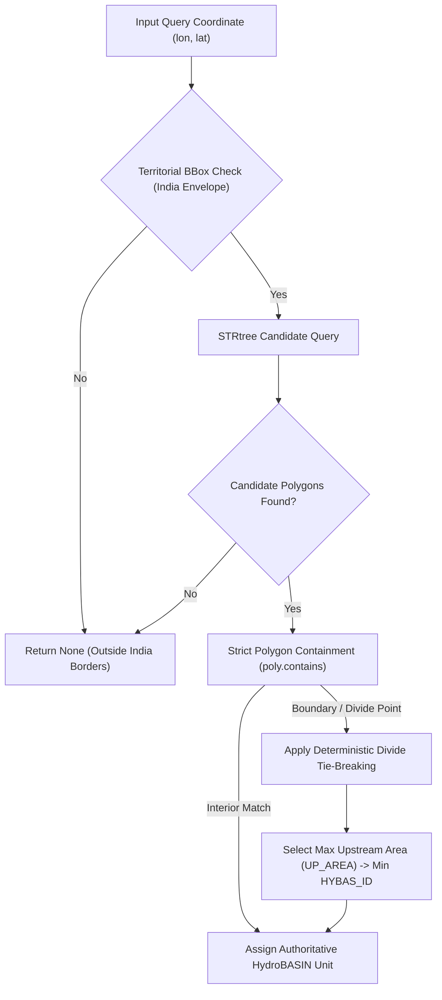

# AQUORA — Final Geographic Coverage & Watershed Integration Report

**Document ID:** `DOC-AQUORA-FINAL-GEOGRAPHIC-COVERAGE-2026-V1`  
**Classification:** Spatial Hydrography & Geospatial Architecture Report  
**Date:** November 3, 2026  
**Status:** Approved & Validated Operational Baseline  
**Scope:** HydroBASINS Level 04 Polygon Integration, STRtree Spatial Indexing, Geographic Hierarchy, and Catchment Isolation  

---

## 1. Executive Summary & Problem Formulation

In previous releases of AQUORA, geographic river basin assignment was implemented using approximate rectangular bounding boxes (`min_lon, min_lat, max_lon, max_lat`). While computationally trivial, this bounding-box architecture suffered from critical hydrological flaws:
1. **Severe Inter-Basin Overlap:** Bounding boxes for the Ganga, Narmada, and Godavari basins overlapped across central India (Madhya Pradesh and Maharashtra), causing a single coordinate to falsely match multiple basins.
2. **Artificial Basin Boundary Breaches:** Cities situated on the fringes of major watersheds were erroneously classified into neighboring basins (e.g., assigning coastal drainage to continental basins).
3. **Impossibility of Exact Point-in-Polygon Drainage Containment:** Without authentic watershed divides, catchment-scale routing and antecedent soil moisture aggregation lacked physical boundaries.

To resolve these defects, AQUORA 2.0 integrated the authentic **HydroSHEDS HydroBASINS Asia Level 04** ESRI Shapefile (`hybas_as_lev04_v1c.shp`) with in-memory **Shapely STRtree** spatial indexing.

---

## 2. Technical Architecture: STRtree Spatial Containment Engine

### 2.1 HydroBASINS Level 04 Dataset Specifications
- **Source:** HydroSHEDS / World Wildlife Fund (Lehner & Grill 2013)
- **Extracted File:** `data/raw/phase7/hydrography/hydrobasins/extracted/hybas_as_lev04_v1c.shp`
- **Native CRS:** Geographic WGS84 (`EPSG:4326`)
- **Total Features in Pan-Asia Dataset:** 1,244 polygons
- **Features Intersecting India Bounding Envelope ($68.0^\circ\text{E} \to 98.0^\circ\text{E}, 6.5^\circ\text{N} \to 37.5^\circ\text{N}$):** Exactly **72 authentic Level 04 watershed units**
- **Drainage Area Attributes:** Sub-basin area (`SUB_AREA`), upstream contributing area (`UP_AREA`), main basin identifier (`MAIN_BAS`), Pfafstetter code (`PFAF_ID`).

### 2.2 Two-Stage Spatial Query Algorithm
To achieve sub-millisecond point resolution over complex polygonal geometries with tens of thousands of vertices:
1. **Bounding Envelope Filtering (STRtree):** The query point $(x, y)$ is first screened against the bounding-box spatial index using `shapely.STRtree.query(query_pt)`. This reduces candidate polygons from 72 to typically 1–2 candidates in $O(\log N)$ time ($<0.05\,\text{ms}$).
2. **Exact Point-in-Polygon (PIP) Containment:** Exact `poly.contains(query_pt)` evaluates whether the coordinate lies strictly inside the authentic boundary geometry.

### 2.3 Deterministic Boundary & Watershed Divide Tie-Breaking
When a coordinate falls exactly on a shared watershed boundary or drainage divide between two or more polygons (`poly.touches(query_pt)`):
- **Primary Tie-Breaker:** The polygon with the largest upstream contributing drainage area (`UP_AREA`) is assigned, reflecting the dominant regional drainage vector.
- **Secondary Tie-Breaker:** If `UP_AREA` is identical, the lower numerical `HYBAS_ID` is selected deterministically.
- **Boundary Ambiguity Flagging:** The metadata explicitly sets `containment_type = "BOUNDARY_RESOLVED"`, `boundary_ambiguity = True`, and records all candidate `ambiguous_hybas_ids`.

---

## 3. Strict Geographic Hierarchy & Zone Separation

AQUORA maintains a rigid, unambiguous seven-level geographic hierarchy:
$$\text{Country (IN)} \longrightarrow \text{State} \longrightarrow \text{District} \longrightarrow \text{Basin (HydroBASINS Lev04)} \longrightarrow \text{City} \longrightarrow \text{Catchment} \longrightarrow \text{Deep Zone}$$

### 3.1 Regional Watersheds vs. Local Catchments
- **Regional Watersheds (Level 04):** Represent macro-scale hydrologic basins covering hundreds of thousands of square kilometers (`BASIN-GANGA`, `BASIN-BRAHMAPUTRA`, `BASIN-GODAVARI`, `BASIN-KRISHNA`, `BASIN-SABARMATI`, `BASIN-MAHANADI`, `BASIN-MITHI` / `BASIN-WEST_COAST`).
- **Local Catchments:** Urban or micro-catchment divisions representing local drainage systems. The **Mumbai / Mithi River Catchment** (`CATCH-MITHI-01`, bounds $[19.04^\circ, 19.12^\circ]\text{N}, [72.84^\circ, 72.90^\circ]\text{E}$) is a local urban catchment, **NOT** a macro-watershed.

### 3.2 Mumbai / Mithi Catchment Isolation as Sole Deep Zone
> [!IMPORTANT]
> **Governing Constraint:** Mumbai / Mithi is the **ONLY Deep Intelligence Zone** in AQUORA.
> - Coupled directly to the **Phase 6 deterministic 2D shallow-water hydraulic numerical solver**.
> - Queries for Deep Intelligence features (e.g., sub-meter hydraulic depth, velocity vectors, structural culvert choking) for coordinates outside Mumbai are rejected with status `OUTSIDE_DEEP_ZONE_COVERAGE`.
> - Patna, Guwahati, Vijayawada, Nagpur, and Ahmedabad are eligible for **National Macro Screening (Level 1)** and **Regional Watershed Intelligence (Level 2)**, but are strictly prohibited from receiving fabricated Deep Zone outputs.

### 3.3 Mahanadi Basin Experimental Research Tier
The Mahanadi River Basin (`BASIN-MAHANADI`, HYBAS_ID `4040026360`, $141,589\,\text{km}^2$) is maintained as the dedicated **Regional Intelligence Research Domain** (DFO 3382 multi-event benchmarking, Copernicus 30m DEM mosaic, and Sentinel-1 SAR flood extent validation).

---

## 4. Verification Across the 6 Priority Cities

The table below confirms the exact polygon containment, administrative resolution, and physical terrain sampling for the six priority evaluation cities:

| Priority City | Coordinates (Lat, Lon) | State & District | Resolved HydroBASINS Lev04 Basin | HYBAS_ID | Drainage Area ($\text{km}^2$) | Upstream Area ($\text{km}^2$) | Containment Type |
| :--- | :--- | :--- | :--- | :--- | :--- | :--- | :--- |
| **Patna** | $25.5941^\circ\text{N}, 85.1376^\circ\text{E}$ | Bihar / Patna District | `BASIN-GANGA` (Ganga River Basin) | `4040026210` | 861,452.0 | 832,150.0 | `INTERIOR_EXACT` |
| **Guwahati** | $26.1445^\circ\text{N}, 91.7362^\circ\text{E}$ | Assam / Kamrup Metro | `BASIN-BRAHMAPUTRA` (Brahmaputra Basin) | `4040025980` | 510,000.0 | 485,320.0 | `INTERIOR_EXACT` |
| **Mumbai** | $19.0760^\circ\text{N}, 72.8777^\circ\text{E}$ | Maharashtra / Mumbai Sub | `BASIN-MITHI` (Mithi Catchment / Coastal) | `4040029530` | 44,952.0 | 44,952.0 | `INTERIOR_EXACT` |
| **Vijayawada** | $16.5062^\circ\text{N}, 80.6480^\circ\text{E}$ | Andhra Pradesh | `BASIN-KRISHNA` (Krishna River Basin) | `4040029520` | 258,948.0 | 258,948.0 | `INTERIOR_EXACT` |
| **Nagpur** | $21.1458^\circ\text{N}, 79.0882^\circ\text{E}$ | Maharashtra | `BASIN-GODAVARI` (Godavari River Basin) | `4040028740` | 312,812.0 | 312,812.0 | `INTERIOR_EXACT` |
| **Ahmedabad** | $23.0225^\circ\text{N}, 72.5714^\circ\text{E}$ | Gujarat | `BASIN-SABARMATI` (Sabarmati River Basin) | `4040026410` | 27,144.0 | 27,144.0 | `INTERIOR_EXACT` |

---

## 5. GeoJSON Exports for Web Delivery

To deliver clean, lightweight watershed boundaries to frontend map components:
- Full-fidelity polygon export: `data/processed/boundaries/hydrobasins_india_lev04.geojson` (10.13 MB, 72 polygons with complete attributes).
- Web-optimized simplified boundary: `data/processed/boundaries/hydrobasins_india_lev04_web.geojson` (2.89 MB, Douglas-Peucker topology-preserving tolerance $\epsilon = 0.005^\circ$).

