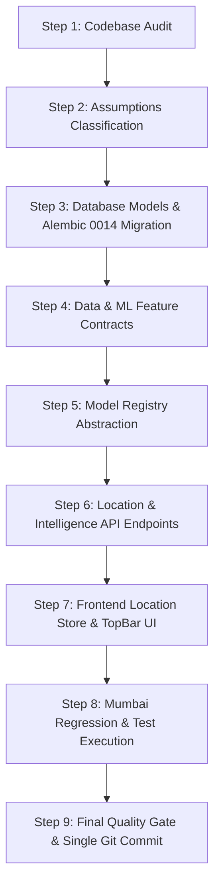

# AQUORA 2.0 — Phase 1 India-Wide Expansion Walkthrough

> **Document Version:** 1.0.0-phase1  
> **Target Release:** AQUORA 2.0 Architectural Foundation  
> **Status:** Architecture Blueprint & Walkthrough  

---

## 1. Executive Summary & Expansion Vision

The long-term objective of **AQUORA 2.0** is to evolve the platform from its initial Mumbai/Mithi proof-of-concept into a unified, multi-tiered Indian flood intelligence system:

```text
               INDIA-WIDE FLOOD INTELLIGENCE
                            │
                            ▼
                    NATIONAL SCREENING
            (Coarse macro-scale risk screening)
                            │
                            ▼
                   REGIONAL INTELLIGENCE
         (State / District / Basin / City level)
                            │
                            ▼
                    DEEP INTELLIGENCE
  (High-resolution physical solver + SAR + local drainage)
                            │
                            ▼
             MUMBAI / MITHI PILOT (ACTIVE)
```

### Critical Boundaries of Phase 1
- **Focus:** **Foundation & Architecture Only.**
- **Preservation:** The existing Mumbai/Mithi high-resolution hydraulic engine, physical solver, simulator, route optimizer, critical facilities access system, and XGBoost prototype remain **100% operational and untouched**.
- **Hard Invariant:** **No heavy India-wide dataset ingestion or downloading** (DEM, GPM archives, national census, or raw Sentinel-1 archives). Data engineering is strictly deferred to Phase 2.
- **Zero Fabrication:** Unsupported regions will not show synthetic flood depths, fabricated risk scores, or false capability indicators.

---

## 2. Complete Codebase Audit Summary

| Tier | Current Architecture | India Expansion Readiness |
| :--- | :--- | :--- |
| **Frontend** | React 18 + Vite + Leaflet + Tailwind. State managed by Zustand (`useAppStore`). Client-side tab routing. | Needs global location hierarchy state (`useLocationStore`) and dynamic capability badges. |
| **Backend** | FastAPI monolith. Async lifespan context. Routers for rainfall, terrain, drainage, flood, calibration, digital twin, routing, critical access, protect city, ground truth, simulator, alerts. | Solid modular structure. Needs `/api/v1/locations` and `/api/v1/intelligence` routers and an extensible model registry. |
| **Database** | PostgreSQL 15 + PostGIS 3.4. 13 Alembic migrations (Head: `0013_phase15_alerts`). 14 production tables. | Ready for migration `0014_phase1_india_hierarchy` to establish spatial entity tree. |
| **Data Assets** | Copernicus 30m DEM, NASA IMERG (E01–E07), ESA WorldCover, 366 OSM/MCGM facilities, Sentinel-1 radar, UHSLC tide gauge. | Mumbai-specific assets are preserved under the Mumbai Deep Zone identifier. |
| **ML Engine** | Kaggle-trained XGBoost prototype (`aquora_xgboost_prototype.joblib`). 12 predictors. Explicitly `PROTOTYPE_ONLY`. | Needs formal model registry abstraction so the backend doesn't assume single-model = Mumbai. |
| **Deployment** | Docker Compose, Render (`render.yaml`), Vercel frontend proxy. | Environment and migrations support clean forward progression. |

---

## 3. Mumbai-Specific Assumptions Classification

Every Mumbai reference found in the codebase has been audited and classified under one of four categories:

| Component / Finding | Code Location | Class | Action & Architecture Treatment |
| :--- | :--- | :---: | :--- |
| **Mithi Bounding Box Constant** (`MUMBAI_MITHI_BOUNDS`) | `digital_twin_service.py:47` | **A. KEEP** | Maintained as the canonical spatial bounds for `zone_id="deep_mumbai_mithi"`. |
| **Study Area ID Default** (`"mithi_catchment_mumbai"`) | `digital_twin.py`, `flood.py` schemas | **B. GENERALIZE** | Generalized to accept dynamic `entity_code`, preserving `"mithi_catchment_mumbai"` as fallback. |
| **Single Model File Loading** (`aquora_xgboost_prototype.joblib`) | `calibration_service.py:61` | **B. GENERALIZE** | Abstracted behind `ModelRegistry` which routes by intelligence level and zone ID. |
| **Frontend Map Center** (`[19.076, 72.8777]`, zoom 13) | `MapContainer.tsx:10` | **B. GENERALIZE** | Parameterized via location store, centering on the active entity centroid. |
| **Header Label `"Mumbai · Mithi Catchment"`** | `TopBar.tsx:96-97` | **B. GENERALIZE** | Connected to location store to display active geographic breadcrumb and tier badge. |
| **366 OSM / MCGM Facilities** | `data/raw/facilities/` | **A. KEEP** | Verified baseline ground truth for the Mumbai Deep Zone. Kept intact. |
| **Mithi Alert Condition Key** (`"MITHI_RIVER_BASIN:ONSET_60M"`) | `alerts_service.py:119` | **A. KEEP** | Valid operational rule for Mithi catchment alert triggers. |
| **OSRM Mumbai Urban Routing** | `routing_service.py` | **C. REFACTOR LATER** | Multi-regional routing will be introduced in Phase 2/3. |

---

## 4. The New India Geographic Hierarchy

The hierarchy is implemented in PostGIS to support infinite spatial nesting across India:

```text
    COUNTRY (e.g., India "IN")
       │
       ▼
    STATE (e.g., Maharashtra "IN-MH")
       │
       ▼
    DISTRICT (e.g., Mumbai Suburban "IN-MH-MUM")
       │
       ▼
    BASIN (e.g., Mithi River Basin "BASIN-MITHI")
       │
       ▼
    CITY (e.g., Mumbai "CITY-MUMBAI")
       │
       ▼
    CATCHMENT (e.g., Mithi Urban Catchment "CATCH-MITHI-01")
       │
       ▼
    LOCATION / GRID (e.g., Kurla Junction Grid Cell "GRID-MUM-4201")
```

### Database Entities (`geographic_entities` & `intelligence_zones`)
- **`geographic_entities` Table**:
  - `id` (UUID, Primary Key)
  - `entity_code` (VARCHAR(64), Unique, Indexed)
  - `name` (VARCHAR(255))
  - `entity_type` (VARCHAR(32), e.g. `COUNTRY`, `STATE`, `DISTRICT`, `BASIN`, `CITY`, `CATCHMENT`, `GRID_CELL`)
  - `parent_id` (UUID, Foreign Key → `geographic_entities.id`, Nullable)
  - `intelligence_level` (VARCHAR(32), `NATIONAL`, `REGIONAL`, `DEEP`)
  - `geom` (Geometry(`GEOMETRY`, srid=4326), Spatial Index)
  - `centroid_lat` (FLOAT), `centroid_lon` (FLOAT)
  - `default_zoom` (INTEGER)
  - `metadata_properties` (JSONB)
- **`intelligence_zones` Table**:
  - `zone_id` (VARCHAR(64), Primary Key)
  - `entity_id` (UUID, Foreign Key → `geographic_entities.id`)
  - `level` (VARCHAR(32), `NATIONAL`, `REGIONAL`, `DEEP`)
  - `status` (VARCHAR(32), `ACTIVE`, `PROTOTYPE`, `PLANNED`)
  - `capabilities` (JSONB: flags for screening, simulation, SAR, radar, routing)
  - `spatial_bounds` (JSONB: `min_lat`, `max_lat`, `min_lon`, `max_lon`)

---

## 5. Standardized Multi-Tier Data Contracts

Standardized data transfer contracts define feature availability across tiers:

```text
┌────────────────────────────────────────────────────────────────────────┐
│                        NATIONAL DATA CONTRACT                          │
│  - Latitude / Longitude               - Rainfall accumulation (1h–72h) │
│  - Rainfall anomaly                   - Copernicus 30m Elevation       │
│  - Regional slope                     - Distance to primary river      │
│  - Historical flood frequency         - Macro land cover class         │
└───────────────────────────────────┬────────────────────────────────────┘
                                    │ Extends
                                    ▼
┌────────────────────────────────────────────────────────────────────────┐
│                        REGIONAL DATA CONTRACT                          │
│  - Basin & sub-catchment metadata     - River basin flow network       │
│  - Regional soil moisture saturation   - District population exposure   │
│  - Critical lifeline asset counts     - Regional weather radar         │
└───────────────────────────────────┬────────────────────────────────────┘
                                    │ Extends
                                    ▼
┌────────────────────────────────────────────────────────────────────────┐
│                          DEEP DATA CONTRACT                            │
│  - D8 flow direction & accumulation   - Surface drainage proxy loss    │
│  - Verified micro facilities (366)    - Building footprint obstruction │
│  - Sentinel-1 SAR bitemporal pair     - Hydrodynamic flood depth grid  │
│  - Safe route departure windows       - Ground truth photo submissions │
└────────────────────────────────────────────────────────────────────────┘
```

---

## 6. Versioned ML Feature Contract (`aquora_ml_feature_schema_v1`)

To prevent training future India-wide models on features that only exist in Mumbai, the versioned feature contract explicitly distinguishes feature tiers:

### 1. CORE NATIONAL FEATURES (`REQUIRED` for all national inference)
- `rainfall_1h_mm`, `rainfall_3h_mm`, `rainfall_6h_mm`, `rainfall_24h_mm`, `rainfall_72h_mm`
- `rainfall_anomaly_index`
- `elevation_m`
- `slope_deg`
- `distance_to_river_m`
- `historical_flood_frequency_score`
- `landcover_class`

### 2. REGIONAL FEATURES (`OPTIONAL`)
- `basin_drainage_area_km2`
- `soil_saturation_index`
- `population_density_per_km2`

### 3. DEEP ZONE EXCLUSIVE (`UNAVAILABLE` at national scale)
- `flow_accumulation_cells` (Requires detailed DEM hydrologic conditioning)
- `drainage_proxy_score` (Requires local micro-catchment sink modeling)
- `built_up_fraction` (Requires high-resolution vector building masks)
- `distance_to_road_m` (Requires fine-scale street geometries)
- `distance_to_waterway_m` (Requires local nalla/stormwater channels)
- `tide_level_m` (Requires local coastal tide gauge)

---

## 7. Model Abstraction & Multi-Zone Registry

Instead of directly querying a single model file, services interact with the `FloodModelRegistry`:

```python
class BaseFloodModel(Protocol):
    """Protocol for all AQUORA flood intelligence models."""
    model_id: str
    intelligence_level: str  # NATIONAL | REGIONAL | DEEP
    model_version: str
    status: str             # PROTOTYPE_ONLY | OPERATIONAL | EXPERIMENTAL

    def predict_risk(self, features: dict[str, Any]) -> dict[str, Any]: ...

class FloodModelRegistry:
    """Dispatches inference requests based on geographic zone and intelligence tier."""
    _registry: dict[str, BaseFloodModel] = {}

    @classmethod
    def get_model(cls, level: str, zone_id: str = "default") -> BaseFloodModel:
        # Returns the registered model or falls back gracefully
        ...
```

- **Mumbai Prototype:** Registered under `level="DEEP"`, `zone_id="deep_mumbai_mithi"` using the existing `aquora_xgboost_prototype.joblib` artifact.
- **National Slot:** Declared as an abstract interface ready for Kaggle Phase 2/3 training without breaking production.

---

## 8. API Architecture

Existing endpoints remain unchanged. New endpoints provide discovery of geographic hierarchy and capability:

```text
GET  /api/v1/locations                    -> Returns India hierarchy tree
GET  /api/v1/locations/{entity_code}      -> Returns entity details, bbox, centroid, children
GET  /api/v1/intelligence/zones           -> Returns all registered intelligence zones
GET  /api/v1/intelligence/capabilities    -> Returns capability matrix for any entity
```

### Example Capability Response:
```json
{
  "entity_code": "IN-MH-MUMBAI",
  "name": "Mumbai",
  "capabilities": {
    "national_screening": "AVAILABLE",
    "regional_intelligence": "AVAILABLE",
    "deep_intelligence": "AVAILABLE"
  },
  "deep_zones": ["deep_mumbai_mithi"],
  "active_zone": "deep_mumbai_mithi"
}
```

```json
{
  "entity_code": "IN-KA-BLR",
  "name": "Bengaluru",
  "capabilities": {
    "national_screening": "FUTURE",
    "regional_intelligence": "FUTURE",
    "deep_intelligence": "NOT_AVAILABLE"
  },
  "deep_zones": [],
  "active_zone": null
}
```

---

## 9. Frontend Architecture Preparation

1. **State Store (`useLocationStore.ts`)**:
   Tracks `selectedCountry`, `selectedState`, `selectedDistrict`, `selectedCity`, `selectedCatchment`, and `currentIntelligenceLevel`. Defaults seamlessly to `India → Maharashtra → Mumbai → Mithi Catchment (DEEP)`.
2. **TopBar Location & Badge Display**:
   Consumes `useLocationStore` to render the dynamic breadcrumb and an indicator pill:
   `[● DEEP ZONE]` (Teal) | `[▲ REGIONAL]` (Blue) | `[■ NATIONAL]` (Slate).
3. **Map Extents**:
   `MapContainer.tsx` is updated to respect the selected location's center and zoom bounds.

---

## 10. Implementation Sequence & Quality Gate



### Explicit Phase 2 Deferred Work:
- Full India Copernicus DEM tiling and preprocessing.
- Nationwide historical rainfall GPM IMERG ingestion.
- Nationwide OSM road and river vector ingestion.
- Kaggle training of India National Screening XGBoost model.
- Nationwide UI map selector and state dropdown controls.
