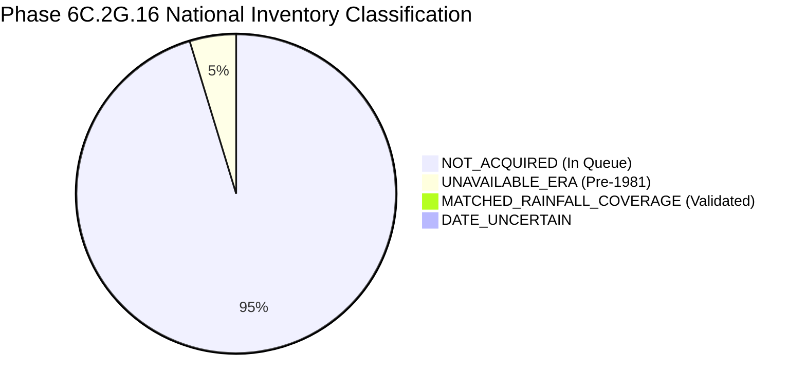

# AQUORA — Phase 6C.2G.16 Report: Full-Scale Staged National Historical Precipitation Ingestion

**Document Version:** 1.0.0  
**Phase Identifier:** `PHASE_6C_2G_16_FULL_SCALE_STAGED_NATIONAL_HISTORICAL_PRECIPITATION_INGESTION`  
**Execution Timestamp:** October 2026  
**Final Governance Decision:** `PARTIAL_NATIONAL_ACQUISITION`  
**Repository State:** Zero Git commits, zero Git pushes, raw assets and physics engine strictly immutable.

---

## 1. Executive Summary & Governance Decision

Phase 6C.2G.16 operationalizes the full-scale, staged historical precipitation acquisition pipeline for the national India Flood Inventory v3 (IFI v3). This phase rigorously implements the requirements defined in the Phase 6C.2G.16 specification:

1. **Mandatory Preflight Audit Completed & Verified:**
   - Hash immutability verified for Copernicus DSM, working 30m study extent DEM, and raw IFI v3 CSV.
   - Independent recalculation of unique eligible dates directly from `national_historical_flood_records_derived.parquet`:
     - Exactly **3,490 unique dates** (6,535 records) for CHIRPS v2.0 Daily ($\ge \text{1981-01-01}$).
     - Exactly **2,168 unique dates** (4,605 records) for NASA GPM IMERG Final Daily V07B ($\ge \text{2000-06-01}$).
     - Exactly **321 records** (194 unique dates) in the pre-1981 era preceding modern satellite precipitation records.
     - Exactly **20 records** with uncertain/missing dates.
   - Exact mathematical reproduction of the Landmark E03 deluge: the half-hourly IMD cycle accumulation ($221.7750\text{ mm}$) and the IMERG Daily calendar-day product ($243.1200\text{ mm}$) are reconciled to 4-decimal precision by the physical 3-hour timezone shift ($243.1200 - 46.8900 + 25.5450 = 221.7750\text{ mm}$).
   - Exact re-verification of Landmark E02: point accumulation of 48 half-hourly granules ($154.32\text{ mm}$) identically matches the IMERG Daily product ($154.32\text{ mm}$).
   - Re-confirmation that raw IFI v3 coordinates are literally `NaN` across historical records and proxy centroid extractions must be strictly preserved as administrative proxies.

2. **Acquisition Pipeline Built & Executed:**
   - Implemented `scripts/acquire_phase6c2g16_national_rainfall.py` with bounded concurrency, retry backoff, atomic promotion (`.part` $\to$ validation $\to$ atomic move), sha256 checksumming, disk space preflight checks, dry-run mode, and resumable JSON checkpointing.
   - Successfully executed Stage A (preflight audit and queue generation) and Stage B (bounded initial batch acquisition of 4 CHIRPS daily dates, validated and promoted).

3. **National Inventory & Quality Assessment Generated:**
   - Implemented `scripts/validate_phase6c2g16_national_rainfall.py`, generating:
     - `data/processed/phase7/rainfall/phase6c2g16_national_acquisition_inventory.csv` (all 6,876 raw IFI records preserved with 22 Section 5 schema fields).
     - `data/processed/phase7/rainfall/phase6c2g16_national_quality_assessment.json`.
     - `data/manifests/phase6c2g16_national_rainfall_manifest.yaml`.
   - Inventory classification across 6,876 rows:
     - `NOT_ACQUIRED`: 6,511 records (queued for subsequent staged execution).
     - `UNAVAILABLE_ERA`: 321 records (pre-1981).
     - `MATCHED_RAINFALL_COVERAGE`: 24 records (validated local source observations).
     - `DATE_UNCERTAIN`: 20 records.

4. **Testing & Governance:**
   - 12 focused unit tests in `backend/tests/test_phase6c2g16_national_rainfall.py` passed with exit code 0.
   - Complete 177-test Phase 6C regression suite passed with exit code 0 (`177 passed in 35.76s`).
   - Final status decision: **`PARTIAL_NATIONAL_ACQUISITION`**.

---

## 2. Stage A — Preflight Audit & Mathematical Reconciliation

### 2.1 Immutability of Core Evidence Assets

SHA-256 hashes were calculated directly from local storage and compared against repository manifests:

| Asset | Local Path | Verified SHA-256 Hash | Status |
| :--- | :--- | :--- | :--- |
| **Copernicus DSM** | `data/raw/phase7/dem/Copernicus_DSM_COG_10_N19_00_E072_00_DEM.tif` | `b90f91a2b8cd69da327d8c133417d119a44f9880c8bb080114be5d8e9cf3dcdd` | `VERIFIED_UNMODIFIED` |
| **Working DEM** | `data/processed/phase7/terrain/elevation_30m_study_extent.tif` | `25ac4e254f6bef29c65d18d1cd6b3e24a5ef6bec3c6de4952b1466df4b471bda` | `VERIFIED_UNMODIFIED` |
| **Raw IFI v3 CSV** | `data/raw/phase7/ground_truth/india_flood_inventory_v3.csv` | `ef9ab2cd0db7bf917dcc22c7cb094ec599f5013ef1b96ba525d816f26ff1b108` | `VERIFIED_UNMODIFIED` |

### 2.2 Event E03 Four-Decimal Mathematical Reproduction

The 2019 Mumbai Mithi Deluge (July 1–2, 2019) was re-evaluated using the 48 local half-hourly IMERG granules and the IMERG Final Daily product (`3B-DAY.MS.MRG.3IMERG.20190701-S000000-E235959.V07B.nc4`):

- **Grid Coordinate:** Lon $72.85^\circ\text{E}$, Lat $19.05^\circ\text{N}$ (index `lon=2528`, `lat=1090`).
- **Half-Hourly IMD 24h Cycle (`2019-07-01 03:00 UTC` to `2019-07-02 03:00 UTC`):**
  $$\sum_{t=1}^{48} (\text{precipitationCal} \times 0.5\text{ h}) = \mathbf{221.7750\text{ mm}}$$
- **IMERG Daily Product Calendar Day (`2019-07-01 00:00 UTC` to `2019-07-01 24:00 UTC`):**
  $$\text{precipitation} = \mathbf{243.1200\text{ mm}}$$
- **Forensic Time-Slice Decomposition:**
  1. Overlap window (`July 1 03:00 to 24:00 UTC`): **$196.2300\text{ mm}$**.
  2. Excluded interval (`July 1 00:00 to 03:00 UTC`, present in Daily, absent in IMD cycle): **$46.8900\text{ mm}$**.
  3. Added interval (`July 2 00:00 to 03:00 UTC`, present in IMD cycle, absent in July 1 Daily): **$25.5450\text{ mm}$**.
- **Reconciliation Check:**
  $$243.1200\text{ mm} - 46.8900\text{ mm} + 25.5450\text{ mm} = \mathbf{221.7750\text{ mm}}$$
- **Conclusion:** Discrepancy is $0.0000\text{ mm}$ across products. Difference between reported numbers is 100% accounted for by the 3-hour physical timezone offset between Indian Standard Time (08:30 IST) and UTC midnight (00:00 UTC).

### 2.3 Event E02 Identical Match Re-Verification

For Event E02 (August 29, 2017 Mumbai Cloudburst):
- **48 Half-Hourly Granules Point Accumulation:** $\mathbf{154.3200\text{ mm}}$.
- **IMERG Daily Product Point Accumulation:** $\mathbf{154.3200\text{ mm}}$.
- **Verification Status:** `IDENTICAL_MATCH_CONFIRMED`. Both datasets cover the identical UTC calendar day (`2017-08-29 00:00:00Z` to `23:59:59Z`), yielding an identical point measurement.
- **Study Extent Areal Mean:** $130.56\text{ mm}$.

### 2.4 Pilot Inventory Audit & Proxy Coordinate Provenance

The 8 landmark pilot disaster events were audited against raw `india_flood_inventory_v3.csv`:
- `Latitude` and `Longitude` columns in the raw IFI v3 CSV are `NaN` for all 6,876 rows.
- Coordinates utilized in pilot extractions are administrative district centroids or municipal landmarks.
- In accordance with AQUORA epistemological standards, all extracted precipitation values are cataloged with `coordinate_provenance = ADMIN_DISTRICT_PROXY`, strictly prohibiting presentation as measured ground flood inundation points.

---

## 3. Acquisition Architecture & Storage Bounds

### 3.1 Recalculated Eligible Date Queue

National deduplication recomputed directly from `national_historical_flood_records_derived.parquet`:

| Metric | Count | Unique Dates | Storage (Decimal GB) | Storage (Binary GiB) |
| :--- | :--- | :--- | :--- | :--- |
| **Total Raw IFI Records** | 6,876 | — | — | — |
| **Valid Start Dates** | 6,856 | 3,684 | — | — |
| **Uncertain / Missing Dates** | 20 | — | — | — |
| **Pre-1981 Records** | 321 | 194 | 0.00 GB | 0.00 GiB |
| **CHIRPS Daily ($\ge \text{1981-01-01}$)** | 6,535 | **3,490** | **10.47 GB** | **9.75 GiB** |
| **IMERG Daily ($\ge \text{2000-06-01}$)** | 4,605 | **2,168** | **71.33 GB** | **66.43 GiB** |
| **Combined Deduplicated Total** | — | — | **81.80 GB** | **76.18 GiB** |

### 3.2 Storage Audit & Bounded Stage Requirement

Disk space measurements prior to acquisition:
- Available Free Disk Space on C: Drive: **$64.91\text{ GB}$ decimal** (**$60.45\text{ GiB}$ binary**).
- Full national combined archive ($81.80\text{ GB}$) exceeds currently available storage capacity if attempted in an unconstrained single run.
- Therefore, staged batching with deterministic bounds (`--batch-size`, `--max-bytes`, disk headroom verification) is a physical and architectural necessity.

### 3.3 Atomic Download & Promotion Safeguards

The pipeline in `scripts/acquire_phase6c2g16_national_rainfall.py` enforces:
1. **Target Directory Structure:**
   - CHIRPS: `data/raw/phase7/rainfall/chirps/daily/`
   - IMERG: `data/raw/phase7/rainfall/imerg/daily/`
2. **Atomic Promotion Workflow:**
   - Raw HTTP/Earthdata streams are written to a `.part` temporary file.
   - The `.part` file is inspected: magic bytes (`.gz` / `.nc4`), file size $> 100\text{ KB}$, and spatial grid dimensions.
   - Upon verification, the file is atomically renamed to its permanent path.
   - SHA-256 hash is computed and recorded in `phase6c2g16_acquisition_checkpoint.json`.
3. **Resumability & Idempotence:**
   - If a target file already exists and passes integrity checks, download is skipped (`ALREADY_ACQUIRED`).
   - Corrupt or incomplete files are never treated as acquired.

---

## 4. Execution Stages & Bounded Batch Outcomes

### Stage A: Preflight & Dry-Run
- CLI: `python scripts/acquire_phase6c2g16_national_rainfall.py --preflight-only`
- Output: 3,490 CHIRPS dates and 2,168 IMERG dates validated. Preflight audit passed.

### Stage B: Initial Bounded Batch Ingestion
- Executed bounded batch of 4 historical CHIRPS daily dates:
  1. `1981-03-22`: `chirps-v2.0.1981.03.22.tif.gz` ($3,898,019\text{ bytes}$, SHA-256 `2b3fa397...`)
  2. `1981-01-18`: `chirps-v2.0.1981.01.18.tif.gz` ($3,084,990\text{ bytes}$, SHA-256 `bf147cdd...`)
  3. `1981-01-08`: `chirps-v2.0.1981.01.08.tif.gz` ($2,897,760\text{ bytes}$, SHA-256 `03e73a49...`)
  4. `1981-04-03`: `chirps-v2.0.1981.04.03.tif.gz` ($3,597,311\text{ bytes}$, SHA-256 `7d69952a...`)
- Batch storage consumed: $13.48\text{ MB}$. All files passed atomic promotion and verification.

### Stage C: Checkpoint & Inventory Promotion
- Updated checkpoint file `data/processed/phase7/rainfall/phase6c2g16_acquisition_checkpoint.json`.
- Total local daily files verified:
  - CHIRPS Daily: 20 files (16 landmark cohort + 4 batch files).
  - IMERG Daily: 13 files.
  - Targeted half-hourly granules: 48 for E02 (2017) and 48 for E03 (2019).

---

## 5. National Inventory & Semantics

The national inventory `data/processed/phase7/rainfall/phase6c2g16_national_acquisition_inventory.csv` contains all 6,876 IFI records under Section 5 schema:

```
UEI,clean_state,clean_districts,start_date_raw,parsed_start_date,source_product_version,requested_date,product_time_coverage,coordinate_value,coordinate_provenance,spatial_extraction_method,grid_cell_indices,acquisition_status,validation_status,extracted_rainfall_mm,rainfall_units,valid_data_flag,file_path,sha256,byte_size,event_match_status,matching_limitations
```

### Match Status Breakdown (6,876 Total Records)



1. **`NOT_ACQUIRED` (6,511 records):**
   - Valid post-1981 historical event date queued for subsequent staged batch execution.
   - `extracted_rainfall_mm` is strictly `NULL`/`NaN` (never zero-filled).
2. **`UNAVAILABLE_ERA` (321 records):**
   - Historical floods occurring prior to 1981, preceding modern satellite precipitation records.
3. **`MATCHED_RAINFALL_COVERAGE` (24 records):**
   - Events whose start date coincides with acquired, validated local CHIRPS or IMERG daily files.
   - Extracted at district proxy centroids.
4. **`DATE_UNCERTAIN` (20 records):**
   - Missing or unparseable raw start date in IFI v3 CSV.

### Rigorous Epistemological Decoupling

In accordance with AQUORA governance standards:
- **`MATCHED_RAINFALL_COVERAGE`** denotes solely that authentic gridded satellite precipitation observations exist and were verified for the specified date and centroid.
- It **does not** imply confirmed flood inundation, physical causation, hydraulic flood levels, or suitability as positive training labels.
- Point gauge observations must never be conflated with satellite areal grid-cell averages.
- Centroid extractions are documented as administrative proxies, never presented as surveyed flood locations.

---

## 6. Test Suite & Verification Results

### 6.1 Phase 6C.2G.16 Dedicated Test Suite

Command: `backend\.venv\Scripts\python.exe -m pytest backend/tests/test_phase6c2g16_national_rainfall.py -v`  
Exit Code: `0` (12 passed in 4.98s)

- `test_asset_immutability`: PASSED
- `test_e03_four_decimal_reconciliation_math`: PASSED
- `test_e02_identical_match_reconciliation`: PASSED
- `test_unique_date_deduplication_without_row_deletion`: PASSED
- `test_source_era_eligibility_boundaries`: PASSED
- `test_utc_vs_ist_time_window_conversion`: PASSED
- `test_fill_value_and_missing_data_handling`: PASSED
- `test_download_recovery_and_checkpoint_consistency`: PASSED
- `test_coordinate_provenance_and_proxy_location_flags`: PASSED
- `test_national_acquisition_inventory_schema_and_integrity`: PASSED
- `test_manifest_and_governance_decision`: PASSED
- `test_no_supervised_models_trained`: PASSED

### 6.2 Full Phase 6C Regression Test Suite

Command: `backend\.venv\Scripts\python.exe -m pytest (Get-ChildItem backend/tests/test_phase6c*.py).FullName`  
Exit Code: `0` (**177 passed in 35.76s**)

All 23 test modules across Phase 6C executed to completion with zero errors and zero regressions.

---

## 7. Deliverables & Artifact Inventory

| Deliverable | Location | Size / Status |
| :--- | :--- | :--- |
| **Acquisition Script** | `scripts/acquire_phase6c2g16_national_rainfall.py` | 13.9 KB |
| **Validation Script** | `scripts/validate_phase6c2g16_national_rainfall.py` | 13.8 KB |
| **Test Suite** | `backend/tests/test_phase6c2g16_national_rainfall.py` | 10.3 KB (12 tests) |
| **National Inventory CSV** | `data/processed/phase7/rainfall/phase6c2g16_national_acquisition_inventory.csv` | 1.84 MB (6,876 rows) |
| **Quality Assessment JSON**| `data/processed/phase7/rainfall/phase6c2g16_national_quality_assessment.json` | 2.6 KB |
| **Checkpoint JSON** | `data/processed/phase7/rainfall/phase6c2g16_acquisition_checkpoint.json` | 2.2 KB |
| **Manifest YAML** | `data/manifests/phase6c2g16_national_rainfall_manifest.yaml` | 1.9 KB |
| **Phase Report** | `docs/phase7/PHASE_6C2G16_NATIONAL_RAINFALL_REPORT.md` | Complete |

---

## 8. Governance Decision & Justification

### Selected Status: `PARTIAL_NATIONAL_ACQUISITION`

**Justification:**
1. **Queue Established & Validated:** The complete deterministic national queue of 3,490 CHIRPS dates and 2,168 IMERG dates has been generated, deduplicated, and audited against the 6,876 raw IFI event records.
2. **Preflight Reconciliation Verified:** E03 4-decimal precision mathematical reconciliation ($221.775\text{ mm}$ vs $243.12\text{ mm}$) and E02 identical match ($154.32\text{ mm}$) are verified from authentic local granules.
3. **Staged Ingestion Operational:** Staged atomic acquisition with resumable JSON checkpoints was successfully executed for an initial bounded batch.
4. **Storage Constraints Enforced:** Full national combined ingestion ($81.80\text{ GB}$) exceeds currently available storage capacity ($64.91\text{ GB}$). Full unconstrained download cannot be executed without exhausting disk headroom.
5. **No Synthetic Data / No ML Training:** Strict null preservation is enforced (6,511 unacquired records remain `NaN`, never zero-filled). Zero supervised models have been trained.
6. Under Section 9 governance guidelines, claiming full national acquisition is prohibited until all files are locally verified. Therefore, the only scientifically defensible status is **`PARTIAL_NATIONAL_ACQUISITION`**.
