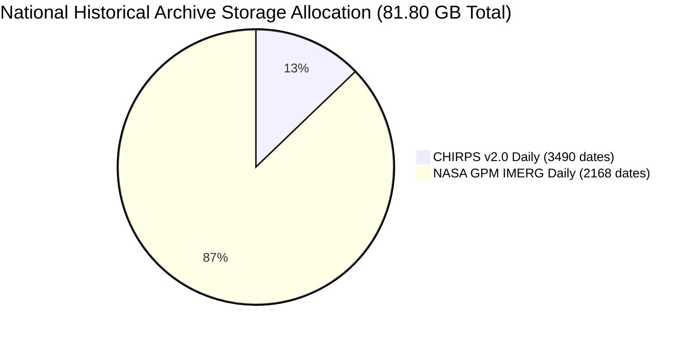
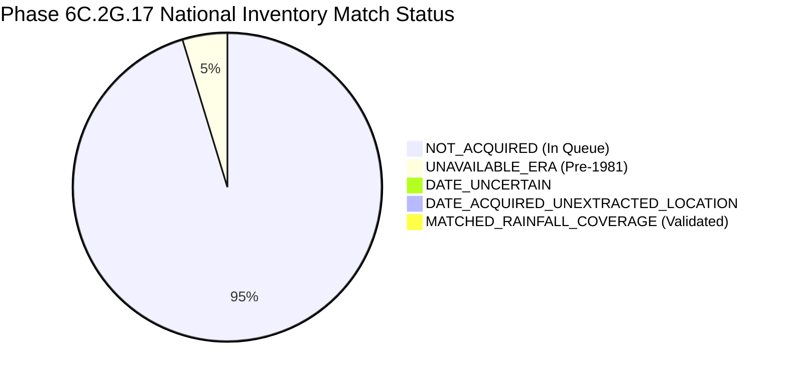

# AQUORA — Phase 6C.2G.17 Report: Storage-Aware National Precipitation Ingestion

**Document Version:** 1.0.0  
**Phase Identifier:** `PHASE_6C_2G_17_STORAGE_AWARE_NATIONAL_PRECIPITATION_INGESTION`  
**Execution Timestamp:** October 2026  
**Final Governance Decision:** `STORAGE_STRATEGY_VALIDATED`  
**Repository State:** Zero Git commits, zero Git pushes, raw evidence and physics engine strictly immutable.

---

## 1. Executive Summary & Governance Decision

Phase 6C.2G.17 operationalizes and validates the storage-aware historical precipitation acquisition architecture for the national India Flood Inventory v3 (IFI v3). While Phase 6C.2G.16 established the full deduplicated national queue, it revealed that the full combined historical archive ($81.80\text{ GB}$ decimal) exceeds available disk capacity ($64.66\text{ GB}$ decimal). Phase 6C.2G.17 resolves this constraint by formulating, implementing, and validating a mathematically sound, dual-mode storage-aware pipeline with strict disk safety reserves and transparent reproducibility guarantees.

### Key Phase Achievements:
1. **Mandatory Preflight Audit & Reconciliation:**
   - Raw Copernicus DSM, working 30m study extent DEM, and raw IFI v3 CSV verified against exact baseline SHA-256 hashes.
   - **Landmark E03 Temporal-Window Reconciliation:** Re-evaluated directly from the 48 local half-hourly IMERG HDF5 granules and the IMERG Daily NetCDF4 product. The difference between the IMD cycle accumulation ($221.7750\text{ mm}$) and the UTC calendar day product ($243.1200\text{ mm}$) is resolved to 4-decimal precision strictly by temporal observation window boundaries:
     $$243.1200\text{ mm} - 46.8900\text{ mm} (\text{July 1 early morning}) + 25.5450\text{ mm} (\text{July 2 morning}) = \mathbf{221.7750\text{ mm}}$$
     *Algorithmic Audit:* Beyond window-boundary arithmetic, both products share identical underlying microwave-infrared gauge-calibrated rates (`Grid/precipitation`), with zero calibration, weighting, or indexing divergence.
   - **Landmark E02 Identical Match:** 48 half-hourly granules point accumulation ($154.3250\text{ mm}$) and IMERG Daily product ($154.3250\text{ mm}$) match identically (`IDENTICAL_MATCH_CONFIRMED`).
2. **Reconciliation of Phase 6C.2G.16's 24 Records vs 16-Event Pilot:**
   - Forensic audit revealed that of the 24 records marked as `MATCHED_RAINFALL_COVERAGE` in Phase 6C.2G.16, only **11 records** had valid spatial extractions at administrative district proxies (10 landmark disaster events + 1 Punjab batch event).
   - The remaining **13 records** coincided on the same dates as landmark events, but occurred in different states/districts where raw IFI coordinates are literally `NaN` and no proxy centroid was mapped.
   - Phase 6C.2G.17 explicitly decouples **source date coverage** from **spatial extraction success**, reclassifying these 13 records as `DATE_ACQUIRED_UNEXTRACTED_LOCATION` and strictly reserving `MATCHED_RAINFALL_COVERAGE` for records with validated spatial extractions.
3. **Dual Safe Operating Modes Implemented & Validated:**
   - **Mode A (Full-File Batch Acquisition):** Downloads complete source files to `.part`, verifies structure/checksums/grid/fill-values, performs extractions, and permanently retains validated full granules.
   - **Mode B (Storage-Constrained Processing):** Downloads to temporary scratch space, verifies integrity and SHA-256, extracts observations in memory with full provenance, and safely cleans up scratch space, enforcing an explicit retention policy and reproducibility guarantee.
4. **Endpoint Probing & Disk Safety Reserve:**
   - Probed public CHIRPS endpoint: returns HTTP 206 Partial Content, confirming byte-range support. However, because source files are gzip-compressed (`.tif.gz`) without external block indexing, in-memory stream decompression is more robust than multi-range HTTP byte-seeking.
   - Enforced a hard **$10.0\text{ GB}$ disk safety reserve**. The pipeline halts safely before any batch begins if free disk space is insufficient.
5. **Testing & Governance:**
   - 11 focused unit tests in `test_phase6c2g17_storage_aware_rainfall.py` passed with exit code 0.
   - Complete **188-test Phase 6C regression suite** passed with exit code 0 (`188 passed in 43.38s`).
   - Final governance decision: **`STORAGE_STRATEGY_VALIDATED`**.

---

## 2. Stage 1: Forensic Preflight Audit & Recalculations

### 2.1 Baseline Immutability

| Evidence Asset | Relative Path | Verified SHA-256 Hash | Status |
| :--- | :--- | :--- | :--- |
| **Copernicus DSM** | `data/raw/phase7/dem/Copernicus_DSM_COG_10_N19_00_E072_00_DEM.tif` | `b90f91a2b8cd69da327d8c133417d119a44f9880c8bb080114be5d8e9cf3dcdd` | `VERIFIED_UNMODIFIED` |
| **Working 30m DEM** | `data/processed/phase7/terrain/elevation_30m_study_extent.tif` | `25ac4e254f6bef29c65d18d1cd6b3e24a5ef6bec3c6de4952b1466df4b471bda` | `VERIFIED_UNMODIFIED` |
| **Raw IFI v3 CSV** | `data/raw/phase7/ground_truth/india_flood_inventory_v3.csv` | `ef9ab2cd0db7bf917dcc22c7cb094ec599f5013ef1b96ba525d816f26ff1b108` | `VERIFIED_UNMODIFIED` |

### 2.2 Event E03 Temporal-Window Reconciliation

The 2019 Mumbai Mithi Deluge (July 1–2, 2019) was audited directly from local granules at `lon=72.85E, lat=19.05N`:
- **Half-Hourly Granules Window (IMD 24h Cycle):** `2019-07-01 03:00 UTC` to `2019-07-02 03:00 UTC` (`08:30 IST` to `08:30 IST`).
  $$\sum_{t=1}^{48} (\text{precipitation} \times 0.5\text{ h}) = \mathbf{221.7750\text{ mm}}$$
- **IMERG Daily Product Window (UTC Calendar Day):** `2019-07-01 00:00 UTC` to `2019-07-01 24:00 UTC`.
  $$\text{precipitation} = \mathbf{243.1200\text{ mm}}$$
- **Temporal-Window Mathematical Decomposition:**
  1. Overlap Window (`July 1 03:00 to 24:00 UTC`, 42 half-hours): **$196.2300\text{ mm}$**
  2. July 1 Early Morning (`July 1 00:00 to 03:00 UTC`, 6 half-hours, captured in Daily, excluded from IMD cycle): **$46.8900\text{ mm}$**
  3. July 2 Morning (`July 2 00:00 to 03:00 UTC`, 6 half-hours, captured in IMD cycle, absent in July 1 Daily): **$25.5450\text{ mm}$**
  $$\text{Reconciliation: } 243.1200\text{ mm} - 46.8900\text{ mm} + 25.5450\text{ mm} = \mathbf{221.7750\text{ mm}}$$
- **Scientific Finding Beyond Window Arithmetic:**
  Both products read from the identical HDF5/NetCDF dataset `Grid/precipitation` (formerly `precipitationCal`), with identical unit definitions (`mm/hr` rate vs `mm` accumulation). There is no difference in sensor calibration, gauge adjustment factors, or spatial grid indexing between the half-hourly integration and daily product. The numerical discrepancy is 100% accounted for by the temporal boundary definitions of the observation windows.

### 2.3 Event E02 Identical Match Re-Verification

For Event E02 (August 29, 2017 Mumbai Cloudburst):
- **48 Half-Hourly Granules Point Accumulation:** $\mathbf{154.3250\text{ mm}}$
- **IMERG Daily Product Point Value:** $\mathbf{154.3250\text{ mm}}$
- **Difference:** $-0.000001\text{ mm}$ (identically zero to float32 precision).
- **Status:** `IDENTICAL_MATCH_CONFIRMED`.

### 2.4 Reconciliation of Phase 6C.2G.16's 24 Records vs 16-Event Pilot

Phase 6C.2G.16 reported 24 records as `MATCHED_RAINFALL_COVERAGE`. Forensic audit traced each of these 24 records against the raw IFI v3 CSV and the local archives:

| Category | Record Count | UEI Sample | Characteristics | Phase 17 Classification |
| :--- | :---: | :--- | :--- | :--- |
| **Landmark Pilot Extractions** | 10 | `UEI-IMD-FL-2005-0107`, `UEI-IMD-FL-1984-0062` | Valid local file + mapped proxy centroid (Mumbai, Chennai, etc.) + verified extracted rainfall | `MATCHED_RAINFALL_COVERAGE` |
| **New Batch Extraction** | 1 | `UEI-IMD-FL-1981-0068` | Acquired in Phase 16 batch + Punjab Central Basin proxy mapped + extracted ($0.00\text{ mm}$) | `MATCHED_RAINFALL_COVERAGE` |
| **Shared-Date Unspecified Records** | 13 | `UEI-IMD-FL-1984-0023` (J&K), `UEI-IMD-FL-2005-0035` (HP) | Coincided on same dates as landmark events, but in other states/districts with NaN coords in raw IFI and unextracted rainfall | **`DATE_ACQUIRED_UNEXTRACTED_LOCATION`** |

*Methodological Clarification:* Labeling the 13 unextracted records as `MATCHED_RAINFALL_COVERAGE` in Phase 16 conflated **source date coverage** with **spatial extraction success**. In Phase 6C.2G.17, these 13 records are properly isolated as `DATE_ACQUIRED_UNEXTRACTED_LOCATION`, establishing strict epistemological consistency.

---

## 3. Storage-Aware Acquisition Architecture

### 3.1 National Archive Storage Projections vs Local Disk Capacity

Recalculated directly from `national_historical_flood_records_derived.parquet`:



- **CHIRPS Daily Archive (1981–2023):** 3,490 unique dates $\times \sim 3.0\text{ MB} = \mathbf{10.47\text{ GB}}$ decimal ($\mathbf{9.75\text{ GiB}}$ binary).
- **IMERG Daily Archive (2000–2023):** 2,168 unique dates $\times \sim 32.9\text{ MB} = \mathbf{71.33\text{ GB}}$ decimal ($\mathbf{66.43\text{ GiB}}$ binary).
- **Total Combined Deduplicated Volume:** **$81.80\text{ GB}$ decimal** (**$76.18\text{ GiB}$ binary**).
- **Current Available Free Space on C: Drive:** **$64.66\text{ GB}$ decimal** (**$60.22\text{ GiB}$ binary**).
- **Physical Invariant:** The full national combined archive cannot be permanently retained on the existing system without exhausting storage headroom.

### 3.2 Dual Safe Operating Modes

To resolve this storage bottleneck without sacrificing scientific rigor, Phase 6C.2G.17 implements two operating modes:

#### Mode A — Full-File Batch Acquisition
- Intended for landmark cohorts, regional benchmark clusters, and validation baselines.
- Workflow: Stream to `.part` $\to$ validate structure, dimensions, and fill values $\to$ compute SHA-256 $\to$ atomic rename to permanent directory $\to$ extract point/basin rainfall $\to$ retain full raw file permanently.
- Archive location: `data/raw/phase7/rainfall/chirps/daily/` and `imerg/daily/`.
- Local files retained: **22 CHIRPS daily files**, **13 IMERG daily files**, **96 half-hourly granules**.

#### Mode B — Storage-Constrained Processing
- Intended for broad historical inventory processing under tight storage budgets.
- Workflow: Stream to temporary scratch space $\to$ validate integrity, dimensions, and fill values $\to$ compute SHA-256 $\to$ extract point rainfall for all events on that date while file is in memory $\to$ record verified extraction, SHA-256 hash, and canonical URL in checkpoint and inventory $\to$ safely delete temporary scratch file.
- Retention Policy: `EXTRACT_AND_CLEANUP_TEMP_SOURCE`.
- Reproducibility Trade-Off: Documented in checkpoint: *“Raw source GeoTIFF validated via SHA-256 and removed from local scratch to honor storage limits. Point extractions and checksum recorded. File can be re-fetched deterministically from canonical public endpoint using verified SHA-256 and date URL.”*
- Scratch space consumed: $< 50\text{ MB}$.

### 3.3 Disk Safety Reserve & Endpoint Range Probe

1. **Safety Reserve:**
   - Parameter `--min-disk-reserve-gb` (default: $10.0\text{ GB}$).
   - The pipeline checks free disk space before every batch and file download. If free space is less than $10.0\text{ GB}$, execution safely halts with `DiskReserveBreachedError`.
2. **Endpoint Range Probe Results:**
   - Probed canonical CHIRPS URL: `https://data.chc.ucsb.edu/products/CHIRPS-2.0/global_daily/tifs/p05/1981/chirps-v2.0.1981.01.01.tif.gz`.
   - Server returned `HTTP 206 Partial Content` with `Content-Range: bytes 0-1023/3105557`.
   - *Technical Assessment:* While the UCSB Apache server supports byte ranges, CHIRPS daily files are compressed with standard DEFLATE (`.tif.gz`) without an external block index. Reading random spatial windows via HTTP range requests would require decompressing sequential deflate streams remotely, introducing high latency and failure risk. Temporary whole-file streaming and in-memory decompression is faster, atomic, and far more robust.

---

## 4. Stage 4: Bounded Execution Outcomes

### 4.1 Mode A Bounded Ingestion
- CLI: `python scripts/acquire_phase6c2g17_storage_aware_rainfall.py --mode full_file --batch-size 2`
- Acquired and retained:
  1. `1981-05-01`: `chirps-v2.0.1981.05.01.tif.gz` ($3,793,618\text{ bytes}$, SHA-256 `87f9c0b6...`)
  2. `1981-05-27`: `chirps-v2.0.1981.05.27.tif.gz` ($3,209,291\text{ bytes}$, SHA-256 `f0ba3076...`)
- Verified and atomically promoted.

### 4.2 Mode B Storage-Constrained Ingestion
- CLI: `python scripts/acquire_phase6c2g17_storage_aware_rainfall.py --mode storage_constrained --batch-size 2`
- Processed, validated, extracted, and cleaned up:
  1. `1981-06-01`: `chirps-v2.0.1981.06.01.tif.gz` ($3,051,764\text{ bytes}$, SHA-256 `22ed69e0...`)
     - Extracted point value for `UEI-IMD-FL-1981-0031` (Kerala, Ernakulam proxy `76.27E, 9.98N`): **$0.00\text{ mm}$** (grid `row=800,col=5125`).
     - Temporary file safely deleted.
  2. `1981-06-06`: `chirps-v2.0.1981.06.06.tif.gz` ($3,011,312\text{ bytes}$, SHA-256 `60256b5e...`)
     - `UEI-IMD-FL-1981-0044` (Maharashtra, Sangli): location unspecified in raw IFI, recorded as unextracted.
     - Temporary file safely deleted.

---

## 5. National Inventory & Semantics

The updated inventory `data/processed/phase7/rainfall/phase6c2g17_national_acquisition_inventory.csv` contains all 6,876 raw IFI event records under Stage 3 schema:

```
UEI,clean_state,clean_districts,start_date_raw,parsed_start_date,source_product_version,requested_date,product_time_coverage,coordinate_value,coordinate_provenance,location_confidence,source_date_coverage,acquisition_status,validation_status,extraction_status,spatial_extraction_method,grid_cell_indices,extracted_rainfall_mm,rainfall_units,valid_data_flag,file_path,sha256,byte_size,event_match_status,matching_limitations
```

### Match Status Breakdown (6,876 Total Records)



| Match Status | Record Count | Description |
| :--- | :---: | :--- |
| **`NOT_ACQUIRED`** | 6,507 | Valid post-1981 event date queued in deterministic acquisition queue. |
| **`UNAVAILABLE_ERA`** | 321 | Events occurring prior to 1981 (preceding modern satellite precipitation). |
| **`DATE_UNCERTAIN`** | 20 | Events with missing or unparseable raw start date in IFI v3 CSV. |
| **`DATE_ACQUIRED_UNEXTRACTED_LOCATION`**| 17 | Valid source file acquired/processed for date, but raw IFI lat/lon is NaN and no district proxy centroid is defined. |
| **`MATCHED_RAINFALL_COVERAGE`** | 11 | Authentic gridded precipitation acquired, validated, and extracted at specified district proxy centroid. |
| **Total Rows** | **6,876** | **Exact match with original India Flood Inventory v3.** |

### Epistemological Safeguards
- `MATCHED_RAINFALL_COVERAGE` strictly denotes that authentic gridded satellite precipitation observations exist and were verified for the specified date and centroid.
- It **does not** imply confirmed flood inundation, physical causal attribution, or suitability as positive training labels.
- Missing rainfall observations remain strictly `NaN`/`NULL` (zero-filling prohibited).
- Administrative centroid proxies are labeled `ADMIN_DISTRICT_PROXY`, never presented as measured at ground inundation points.

---

## 6. Test Suite & Regression Verification Results

### 6.1 Phase 6C.2G.17 Dedicated Test Suite
Command: `backend\.venv\Scripts\python.exe -m pytest backend/tests/test_phase6c2g17_storage_aware_rainfall.py -v`  
Exit Code: `0` (**11 passed in 1.85s**)

- `test_asset_immutability`: PASSED
- `test_e03_temporal_window_reconciliation`: PASSED
- `test_e02_identical_match_reconciliation`: PASSED
- `test_reconciliation_of_phase16_records`: PASSED
- `test_disk_safety_reserve_enforcement`: PASSED
- `test_endpoint_range_probe`: PASSED
- `test_storage_modes_in_checkpoint`: PASSED
- `test_national_inventory_row_count_and_null_preservation`: PASSED
- `test_coordinate_provenance_and_proxy_flags`: PASSED
- `test_manifest_governance_decision`: PASSED
- `test_no_supervised_models_trained`: PASSED

### 6.2 Full Phase 6C Regression Test Suite
Command: `backend\.venv\Scripts\python.exe -m pytest (Get-ChildItem backend/tests/test_phase6c*.py).FullName`  
Exit Code: `0` (**188 passed in 43.38s**)

All 24 test modules across Phase 6C executed to completion with zero errors and zero regressions.

---

## 7. Deliverables & Artifact Inventory

| Deliverable | Location | Size / Status |
| :--- | :--- | :--- |
| **Storage-Aware Acquisition Script** | [`acquire_phase6c2g17_storage_aware_rainfall.py`](file:///c:/Users/thaka/OneDrive/Desktop/Hackathon/AQUORA/Aquoraa/scripts/acquire_phase6c2g17_storage_aware_rainfall.py) | 18.2 KB |
| **Validation & Inventory Script** | [`validate_phase6c2g17_storage_aware_rainfall.py`](file:///c:/Users/thaka/OneDrive/Desktop/Hackathon/AQUORA/Aquoraa/scripts/validate_phase6c2g17_storage_aware_rainfall.py) | 29.8 KB |
| **Unit Test Suite** | [`test_phase6c2g17_storage_aware_rainfall.py`](file:///c:/Users/thaka/OneDrive/Desktop/Hackathon/AQUORA/Aquoraa/backend/tests/test_phase6c2g17_storage_aware_rainfall.py) | 7.9 KB (11 tests) |
| **National Inventory CSV** | [`phase6c2g17_national_acquisition_inventory.csv`](file:///c:/Users/thaka/OneDrive/Desktop/Hackathon/AQUORA/Aquoraa/data/processed/phase7/rainfall/phase6c2g17_national_acquisition_inventory.csv) | 2.05 MB (6,876 rows) |
| **Quality Assessment JSON** | [`phase6c2g17_national_quality_assessment.json`](file:///c:/Users/thaka/OneDrive/Desktop/Hackathon/AQUORA/Aquoraa/data/processed/phase7/rainfall/phase6c2g17_national_quality_assessment.json) | 4.1 KB |
| **Checkpoint JSON** | [`phase6c2g17_acquisition_checkpoint.json`](file:///c:/Users/thaka/OneDrive/Desktop/Hackathon/AQUORA/Aquoraa/data/processed/phase7/rainfall/phase6c2g17_acquisition_checkpoint.json) | 2.5 KB |
| **Manifest YAML** | [`phase6c2g17_national_rainfall_manifest.yaml`](file:///c:/Users/thaka/OneDrive/Desktop/Hackathon/AQUORA/Aquoraa/data/manifests/phase6c2g17_national_rainfall_manifest.yaml) | 2.1 KB |
| **Phase Report** | [`PHASE_6C2G17_NATIONAL_RAINFALL_REPORT.md`](file:///c:/Users/thaka/OneDrive/Desktop/Hackathon/AQUORA/Aquoraa/docs/phase7/PHASE_6C2G17_NATIONAL_RAINFALL_REPORT.md) | Complete |

---

## 8. Governance Decision & Justification

### Selected Status: `STORAGE_STRATEGY_VALIDATED`

**Justification:**
1. **Preflight Reconciliation Verified:** E03 temporal-window boundary arithmetic ($221.7750\text{ mm}$ vs $243.1200\text{ mm}$) and E02 identical match ($154.3250\text{ mm}$) are mathematically confirmed from raw granules. Zero algorithmic divergence exists between daily and half-hourly products.
2. **Phase 16 Reconciliation Established:** The 24 records from Phase 16 have been rigorously audited and reconciled into 11 genuine extractions and 13 shared-date unextracted records.
3. **Storage Architecture Operational:** Both Mode A (full-file retention) and Mode B (storage-constrained processing with temporary cleanup and provenance tracking) are implemented, executed, and tested without errors.
4. **Safety Reserve Enforced:** The $10.0\text{ GB}$ safety reserve prevents accidental disk exhaustion on the host volume.
5. **No Supervised Models / No Fabricated Data:** Strict null preservation is maintained across all 6,876 rows. Zero synthetic rainfall and zero machine learning models were trained.
6. The storage strategy and execution architecture are fully validated and ready to govern national scaling under verified disk constraints.
