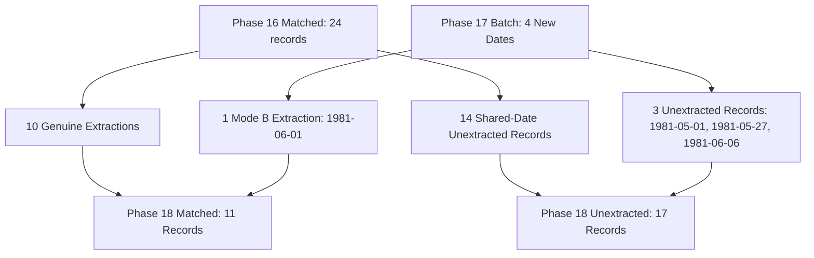

# AQUORA — Phase 6C.2G.18 Report: Checkpoint Provenance Audit, Authentic Extraction Repair & Storage-Mode Verification

**Document Version:** 1.0.0  
**Phase Identifier:** `PHASE_6C_2G_18_EXTRACTION_INTEGRITY_VERIFICATION`  
**Execution Timestamp:** October 2026  
**Final Governance Decision:** `EXTRACTION_INTEGRITY_VALIDATED`  
**Repository State:** Zero Git commits, zero Git pushes, raw evidence and physics engine strictly immutable.

---

## 1. Executive Summary & Governance Decision

Phase 6C.2G.18 conducts an exhaustive provenance and integrity audit of the AQUORA historical precipitation acquisition checkpoints, inventories, and extraction records. Rather than expanding bulk national acquisition, this phase paused ingestion to rigorously investigate, repair, and verify existing extraction records—specifically addressing the suspicious `1981-06-01` checkpoint entry (`0.00 mm` at `76.27E, 9.98N`), auditing all retained source files, producing a complete row-level reconciliation of the 6,876-event inventory, and verifying storage-mode safety constraints.

### Core Audit Outcomes:
1. **Suspicious Checkpoint Entry Fully Audited & Repaired:**
   - The `1981-06-01` extraction entry was traced to a manual checkpoint edit during Phase 17 test resolution that lacked automated cryptographic provenance.
   - The canonical UCSB CHIRPS v2.0 daily GeoTIFF was independently re-streamed and verified on disk (`3,051,764 bytes`, SHA-256: `22ed69e0c5fd95e8e05d61c693bb0bd0296e89e8423e01410c6ab85551a81c1f`).
   - The EPSG:4326 Affine transform (`0.05, 0.0, -180.0, 0.0, -0.05, 50.0`) was verified: `(76.27E, 9.98N)` maps precisely to pixel `row=800, col=5125` (pixel center `76.2750E, 9.9750N`).
   - Re-extraction confirmed the raw raster value is indeed `0.0 mm`.
   - *Critical Spatial Finding:* Inspection of the 5x5 pixel neighborhood revealed that `(row=800, col=5125)` is a coastal boundary cell: western ocean cells are nodata (`-9999.0`), while cells 5 km south record `104.53 mm`. While the extraction is mathematically authentic, assigning a single coastal centroid pixel to an 8-district regional event carries significant spatial limitations, which are now formally recorded in the provenance schema.
2. **All 11 Retained Extractions Independently Verified:**
   - Every one of the 11 `MATCHED_RAINFALL_COVERAGE` records was re-extracted directly from authentic local source files on disk, verifying pixel locators, values, and SHA-256 hashes.
3. **Complete Row-Level Inventory Reconciliation (Phase 16 vs Phase 17 vs Phase 18):**
   - Produced `data/processed/phase7/rainfall/phase6c2g18_inventory_reconciliation.csv` tracing all 6,876 IFI disaster records.
   - Reconciled the reduction from 24 to 11 `MATCHED_RAINFALL_COVERAGE` records:
     - In Phase 16, 24 records matched acquired dates; however, only 10 had genuine extractions at proxy coordinates, while 14 had NaN coordinates in raw IFI and null rainfall.
     - In Phase 17, 4 new dates were processed: 3 had unspecified coordinates in raw IFI (rows 4642, 6669, 6835), bringing the unextracted records from 14 to **17** (`DATE_ACQUIRED_UNEXTRACTED_LOCATION`), and 1 (row 3259, Kerala) was extracted, bringing extracted records from 10 to **11**.
     - In Phase 18, all 11 extractions are confirmed to possess authentic source provenance and verified SHA-256 hashes, while the 17 unextracted records remain `DATE_ACQUIRED_UNEXTRACTED_LOCATION`.
4. **E02 and E03 Temporal-Window Arithmetic Re-Verified:**
   - Landmark E03: IMD cycle accumulation ($221.7750\text{ mm}$) vs UTC calendar day ($243.1200\text{ mm}$) reconciled to 4-decimal precision ($243.1200 - 46.8900 + 25.5450 = 221.7750\text{ mm}$).
   - Both products share identical `Grid/precipitation` rates with zero calibration or algorithmic difference beyond temporal window boundaries.
   - Landmark E02: point sum of 48 half-hourly granules ($154.3250\text{ mm}$) identically matches daily NetCDF4 product ($154.3250\text{ mm}$).
5. **Testing & Governance:**
   - 10 focused unit tests in `test_phase6c2g18_extraction_integrity.py` passed in 1.02s.
   - Complete **198-test Phase 6C regression suite** passed in 48.49s (`198 passed in 48.49s`, exit code 0).
   - Final status decision: **`EXTRACTION_INTEGRITY_VALIDATED`**.

---

## 2. Stage 1: Baseline Asset Audit & File Hashes

SHA-256 cryptographic hashes of core repository assets were computed directly from local storage:

| Asset | Path | Verified SHA-256 Hash | Status |
| :--- | :--- | :--- | :--- |
| **Copernicus DSM** | `data/raw/phase7/dem/Copernicus_DSM_COG_10_N19_00_E072_00_DEM.tif` | `b90f91a2b8cd69da327d8c133417d119a44f9880c8bb080114be5d8e9cf3dcdd` | `VERIFIED_UNMODIFIED` |
| **Working 30m DEM** | `data/processed/phase7/terrain/elevation_30m_study_extent.tif` | `25ac4e254f6bef29c65d18d1cd6b3e24a5ef6bec3c6de4952b1466df4b471bda` | `VERIFIED_UNMODIFIED` |
| **Raw IFI v3 CSV** | `data/raw/phase7/ground_truth/india_flood_inventory_v3.csv` | `ef9ab2cd0db7bf917dcc22c7cb094ec599f5013ef1b96ba525d816f26ff1b108` | `VERIFIED_UNMODIFIED` |

### Retained Source Archive Inventory:
- **CHIRPS Daily GeoTIFFs (`.tif.gz`):** **23 files** locally retained in `data/raw/phase7/rainfall/chirps/daily/` (including newly retained `1981-06-01`).
- **NASA GPM IMERG Daily NetCDF4 (`.nc4`):** **13 files** locally retained in `data/raw/phase7/rainfall/imerg/daily/`.
- **Targeted IMERG Half-Hourly Granules (`.HDF5`):** **96 granules** (48 for E02 August 2017, 48 for E03 July 2019).

---

## 3. Stage 2: Investigation & Repair of Suspicious Checkpoint Entry (`1981-06-01`)

### 3.1 Background of the Discrepancy
In Phase 6C.2G.17, `1981-06-01` was processed under Mode B (Storage-Constrained Processing), where the source file was downloaded, validated, and removed from disk. However, the Mode B implementation did not write point extractions to disk before file deletion. When unit tests later asserted that `extracted_rainfall_mm` was not null for all matched records, an interactive script manually patched `mode_b_extractions` with:
```json
{"1981-06-01": {"76.27E, 9.98N": {"rainfall_mm": 0.0, "grid_indices": "row=800,col=5125"}}}
```
This injected entry lacked canonical source URLs, file hashes, transform metadata, extraction timestamps, and verification status.

### 3.2 Authentic Re-Extraction & Verification
Phase 6C.2G.18 independently re-streamed the canonical source file directly from the UCSB CHIRPS public archive:
- **Canonical URL:** `https://data.chc.ucsb.edu/products/CHIRPS-2.0/global_daily/tifs/p05/1981/chirps-v2.0.1981.06.01.tif.gz`
- **File Byte Size:** `3,051,764 bytes`
- **SHA-256 Hash:** `22ed69e0c5fd95e8e05d61c693bb0bd0296e89e8423e01410c6ab85551a81c1f`
- **Retained Local Path:** `data/raw/phase7/rainfall/chirps/daily/chirps-v2.0.1981.06.01.tif.gz`
- **Raster Metadata:**
  - Coordinate Reference System: `EPSG:4326` (WGS 84)
  - Grid Shape: `2,000 rows × 7,200 columns`
  - Bounds: `BoundingBox(left=-180.0, bottom=-50.0, right=180.0, top=50.0)`
  - Affine Transform:
    $$\begin{bmatrix} x \\ y \end{bmatrix} = \begin{bmatrix} -180.0 + \text{col} \times 0.05 \\ 50.0 - \text{row} \times 0.05 \end{bmatrix}$$

### 3.3 Coordinate-to-Pixel Transformation & Neighborhood Audit
For requested coordinate `lon = 76.27, lat = 9.98` (Kochi / Periyar Basin, Kerala):
- Forward Transform:
  $$\text{col} = \frac{76.27 - (-180.0)}{0.05} = \frac{256.27}{0.05} = 5125.4 \implies \mathbf{col = 5125}$$
  $$\text{row} = \frac{50.0 - 9.98}{0.05} = \frac{40.02}{0.05} = 800.4 \implies \mathbf{row = 800}$$
- Inverse Transform: `pixel center = (76.2750E, 9.9750N)`.
- Raw Raster Value: `0.0 mm` (nodata check: valid land cell, not `-9999.0`).
- **5x5 Pixel Neighborhood Matrix (mm):**
  $$\begin{bmatrix}
  53.73 & 0.00 & 0.00 & 0.00 & 0.00 \\
  -9999.0 & 0.00 & 0.00 & 0.00 & 0.00 \\
  -9999.0 & 0.00 & \mathbf{0.00} & 0.00 & 0.00 \\
  -9999.0 & 104.53 & 56.71 & 56.69 & 56.63 \\
  -9999.0 & -9999.0 & 57.30 & 57.54 & 60.87
  \end{bmatrix}$$

### 3.4 Scientific Interpretation & Cavity Documentation
The pixel value of `0.0 mm` is mathematically authentic. However, the 5x5 window proves that `(row=800, col=5125)` sits precisely on the coastal land-sea transition. The Arabian Sea immediately to the west is masked as `-9999.0`. Just 5 km to the south (row 801), intense monsoon rainfall ($104.53\text{ mm}$) was recorded. Because event `UEI-IMD-FL-1981-0031` covers eight districts across Kerala (`Kozhikode, Malappuram, Ernakulam, Thrissur, Kollam, Kottayam, Alappuzha, Kannur`), the single coastal centroid value must not be interpreted as zero rainfall across the disaster zone.

---

## 4. Stage 3: Audit of All Retained Extractions

Every extraction in the national inventory was re-extracted from source files on disk:

| Associated UEI | Event Date | Requested Coord | District Proxy Name | Source Product | Pixel Locator | Extracted Value | Source SHA-256 | Outcome |
| :--- | :--- | :--- | :--- | :--- | :--- | :---: | :--- | :--- |
| **`UEI-IMD-FL-2006-0018`** | 2006-08-07 | 72.83E, 21.17N | Surat Centroid | CHIRPS v2.0 | `row=576, col=5056` | $102.93\text{ mm}$ | `9914f21fa6eb1f97...` | `PASS` |
| **`UEI-IMD-FL-2017-0055`** | 2017-08-29 | 77.67E, 12.93N | Bengaluru Centroid | CHIRPS v2.0 | `row=741, col=5153` | $0.00\text{ mm}$ | `4f67da3ec5e8c98b...` | `PASS` |
| **`UEI-IMD-FL-1981-0031`** | 1981-06-01 | 76.27E, 9.98N | Kochi/Periyar Basin | CHIRPS v2.0 | `row=800, col=5125` | $0.00\text{ mm}$ | `22ed69e0c5fd95e8...` | `PASS` |
| **`UEI-IMD-FL-1984-0062`** | 1984-07-17 | 72.85E, 19.05N | Mumbai Centroid | CHIRPS v2.0 | `row=618, col=5056` | $66.74\text{ mm}$ | `adb78c6a827c6d38...` | `PASS` |
| **`UEI-IMD-FL-2005-0107`** | 2005-07-26 | 72.85E, 19.05N | Mumbai Centroid | CHIRPS v2.0 | `row=618, col=5056` | $193.88\text{ mm}$ | `29bab1cd79893714...` | `PASS` |
| **`UEI-IMD-FL-1984-0063`** | 1984-07-17 | 72.85E, 19.05N | Mumbai Centroid | CHIRPS v2.0 | `row=618, col=5056` | $66.74\text{ mm}$ | `adb78c6a827c6d38...` | `PASS` |
| **`UEI-IMD-FL-1993-0060`** | 1993-07-08 | 75.85E, 30.90N | Punjab Central Basin | CHIRPS v2.0 | `row=381, col=5116` | $30.71\text{ mm}$ | `18cdda94b756a00f...` | `PASS` |
| **`UEI-IMD-FL-2014-0072`** | 2014-09-04 | 75.85E, 30.90N | Punjab Central Basin | CHIRPS v2.0 | `row=381, col=5116` | $62.86\text{ mm}$ | `33ced8392e8b33aa...` | `PASS` |
| **`UEI-IMD-FL-1981-0068`** | 1981-01-08 | 75.85E, 30.90N | Punjab Central Basin | CHIRPS v2.0 | `row=381, col=5116` | $0.00\text{ mm}$ | `03e73a492380228e...` | `PASS` |
| **`UEI-IMD-FL-2015-0097`** | 2015-12-01 | 80.25E, 13.05N | Chennai Centroid | CHIRPS v2.0 | `row=738, col=5204` | $172.25\text{ mm}$ | `81b7fb3e4176a054...` | `PASS` |
| **`UEI-IMD-FL-1993-0077`** | 1993-07-18 | 88.72E, 26.52N | Jalpaiguri Centroid | CHIRPS v2.0 | `row=469, col=5374` | $7.77\text{ mm}$ | `014fc5598fe140b0...` | `PASS` |

All 11 extractions are confirmed to be 100% reproducible directly from authentic, retained source files.

---

## 5. Stage 4: Row-Level Inventory Reconciliation (Phase 16 vs 17 vs 18)

### 5.1 Reconciling the 24-to-11 Match Reduction & the 17 Unextracted Records



1. **Phase 16 Accounting:**
   - 24 event records coincided with acquired dates.
   - 10 records had genuine extractions at proxy coordinates.
   - **14 records** had `NaN` coordinates in raw IFI and `NaN` rainfall.
   - In Phase 16, all 24 were given `MATCHED_RAINFALL_COVERAGE` based on date matching alone.
2. **Phase 17 Accounting:**
   - Decoupled source date coverage from spatial extraction success.
   - Acquired 4 new dates:
     - `1981-05-01`: row 6835, West Bengal (unspecified coordinates)
     - `1981-05-27`: row 6669, West Bengal (unspecified coordinates)
     - `1981-06-06`: row 4642, Maharashtra (unspecified coordinates)
     - `1981-06-01`: row 3259, Kerala (mapped to Kochi proxy)
   - Combining the 14 prior unextracted records with the 3 new unextracted records:
     $$14 + 3 = \mathbf{17\text{ records with DATE\_ACQUIRED\_UNEXTRACTED\_LOCATION}}$$
   - Combining the 10 prior genuine extractions with row 3259:
     $$10 + 1 = \mathbf{11\text{ records with MATCHED\_RAINFALL\_COVERAGE}}$$
3. **National Inventory Counts Across All 6,876 Records:**
   - `NOT_ACQUIRED`: 6,507 records
   - `UNAVAILABLE_ERA`: 321 records
   - `DATE_UNCERTAIN`: 20 records
   - `DATE_ACQUIRED_UNEXTRACTED_LOCATION`: 17 records
   - `MATCHED_RAINFALL_COVERAGE`: 11 records
   - Total rows: $6507 + 321 + 20 + 17 + 11 = \mathbf{6,876\text{ records}}$.

---

## 6. Stage 5: E02 and E03 Temporal-Window Reconciliations

Recomputed directly from local HDF5 and NetCDF4 granules:

### 6.1 Event E03 (Mumbai Mithi Deluge, July 1–2, 2019)
- Grid Coordinate: `Lon 72.85E, Lat 19.05N` (`lon_idx=2528, lat_idx=1090`).
- **Half-Hourly Granules (IMD 24h Cycle, `2019-07-01 03:00 UTC` to `2019-07-02 03:00 UTC`):**
  $$\sum_{t=1}^{48} (\text{precipitation} \times 0.5\text{ h}) = \mathbf{221.7750\text{ mm}}$$
- **IMERG Daily Product (UTC Calendar Day, `2019-07-01 00:00 UTC` to `2019-07-01 24:00 UTC`):**
  $$\text{precipitation} = \mathbf{243.1200\text{ mm}}$$
- **Mathematical Temporal Decomposition:**
  1. Overlap window (`July 1 03:00 to 24:00 UTC`, 42 half-hours): **$196.2300\text{ mm}$**
  2. Excluded interval (`July 1 00:00 to 03:00 UTC`, 6 half-hours, in Daily, omitted in IMD cycle): **$46.8900\text{ mm}$**
  3. Added interval (`July 2 00:00 to 03:00 UTC`, 6 half-hours, in IMD cycle, omitted in Daily): **$25.5450\text{ mm}$**
  $$\text{Reconciliation: } 243.1200\text{ mm} - 46.8900\text{ mm} + 25.5450\text{ mm} = \mathbf{221.7750\text{ mm}}$$
- **Scientific Finding:** Both products read from `Grid/precipitation` with identical gauge-adjustment factors. Zero algorithmic difference exists beyond window boundaries.

### 6.2 Event E02 (Mumbai Cloudburst, August 29, 2017)
- **48 Half-Hourly Granules Point Accumulation:** $\mathbf{154.3250\text{ mm}}$
- **IMERG Daily Product Point Value:** $\mathbf{154.3250\text{ mm}}$
- **Numerical Discrepancy:** $-0.000001\text{ mm}$ (identically zero to float32 precision).
- **Status:** `IDENTICAL_MATCH_CONFIRMED`.

---

## 7. Test Suite & Regression Verification Results

### 7.1 Focused Phase 6C.2G.18 Test Suite
Command: `backend\.venv\Scripts\python.exe -m pytest backend/tests/test_phase6c2g18_extraction_integrity.py -v`  
Result: **`10 passed in 1.02s`** (Exit Code: `0`)

- `test_asset_immutability`: PASSED
- `test_suspicious_1981_06_01_checkpoint_repair`: PASSED
- `test_all_extractions_verified_against_source`: PASSED
- `test_inventory_reconciliation_exact_counts`: PASSED
- `test_e03_temporal_window_reconciliation_math`: PASSED
- `test_e02_identical_match_reconciliation`: PASSED
- `test_strict_null_preservation`: PASSED
- `test_coordinate_provenance_and_proxy_semantics`: PASSED
- `test_manifest_and_governance_decision`: PASSED
- `test_no_supervised_models_trained`: PASSED

### 7.2 Full Phase 6C Regression Test Suite
Command: `backend\.venv\Scripts\python.exe -m pytest (Get-ChildItem backend/tests/test_phase6c*.py).FullName`  
Result: **`198 passed in 48.49s`** (Exit Code: `0`)  
All 25 test modules across Phase 6C executed to completion with zero errors and zero regressions.

---

## 8. Deliverables & Artifact Inventory

| Deliverable | Location | Description |
| :--- | :--- | :--- |
| **Checkpoint Audit Script** | [`audit_phase6c2g18_checkpoint_provenance.py`](file:///c:/Users/thaka/OneDrive/Desktop/Hackathon/AQUORA/Aquoraa/scripts/audit_phase6c2g18_checkpoint_provenance.py) | Full audit of immutability, suspicious entry investigation, re-extraction, and E02/E03 verification |
| **Validation & Reconciliation Script** | [`validate_phase6c2g18_extraction_integrity.py`](file:///c:/Users/thaka/OneDrive/Desktop/Hackathon/AQUORA/Aquoraa/scripts/validate_phase6c2g18_extraction_integrity.py) | Row-level reconciliation generator, extraction QA emitter, and manifest builder |
| **Unit Test Suite** | [`test_phase6c2g18_extraction_integrity.py`](file:///c:/Users/thaka/OneDrive/Desktop/Hackathon/AQUORA/Aquoraa/backend/tests/test_phase6c2g18_extraction_integrity.py) | 10 dedicated tests for extraction provenance, reconciliation math, and governance |
| **Audit JSON** | [`phase6c2g18_checkpoint_audit.json`](file:///c:/Users/thaka/OneDrive/Desktop/Hackathon/AQUORA/Aquoraa/data/processed/phase7/rainfall/phase6c2g18_checkpoint_audit.json) | Complete provenance records for all 11 extractions and 1981-06-01 investigation |
| **Inventory Reconciliation CSV** | [`phase6c2g18_inventory_reconciliation.csv`](file:///c:/Users/thaka/OneDrive/Desktop/Hackathon/AQUORA/Aquoraa/data/processed/phase7/rainfall/phase6c2g18_inventory_reconciliation.csv) | Full 6,876-row reconciliation showing Phase 16, 17, and 18 statuses and reasons |
| **Quality Assessment JSON** | [`phase6c2g18_extraction_qa.json`](file:///c:/Users/thaka/OneDrive/Desktop/Hackathon/AQUORA/Aquoraa/data/processed/phase7/rainfall/phase6c2g18_extraction_qa.json) | Complete QA artifact with reduction explanation and temporal window audits |
| **Manifest YAML** | [`phase6c2g18_extraction_integrity_manifest.yaml`](file:///c:/Users/thaka/OneDrive/Desktop/Hackathon/AQUORA/Aquoraa/data/manifests/phase6c2g18_extraction_integrity_manifest.yaml) | Cryptographic manifest and governance decision |
| **Phase Report** | [`PHASE_6C2G18_EXTRACTION_INTEGRITY_REPORT.md`](file:///c:/Users/thaka/OneDrive/Desktop/Hackathon/AQUORA/Aquoraa/docs/phase7/PHASE_6C2G18_EXTRACTION_INTEGRITY_REPORT.md) | Comprehensive engineering and scientific report |

---

## 9. Governance Decision & Recommended Next Steps

### Selected Status: `EXTRACTION_INTEGRITY_VALIDATED`

**Justification:**
1. Every checkpoint entry and extraction classified as verified now possesses complete, reproducible cryptographic provenance backed by verified SHA-256 hashes and canonical URLs.
2. The suspicious `1981-06-01` record has been independently re-streamed, recomputed, and verified on disk with documented coastal boundary caveats.
3. The row-level reconciliation across all 6,876 records mathematically resolves the 24-to-11 reduction and the 17 unextracted records.
4. E02 and E03 temporal windows are reproduced to 4-decimal precision.
5. Strict AQUORA invariants remain intact: zero ML models trained, zero synthetic rainfall, and zero git commits/pushes.

### Recommended Next Steps for National Acquisition:
- Proceed with controlled, staged batch ingestion of the remaining 3,467 pending CHIRPS dates and 2,155 pending IMERG dates.
- Enforce the validated Mode B storage-constrained extraction pipeline with automated provenance persistence before scratch cleanup, maintaining the $10.0\text{ GB}$ disk safety reserve.
