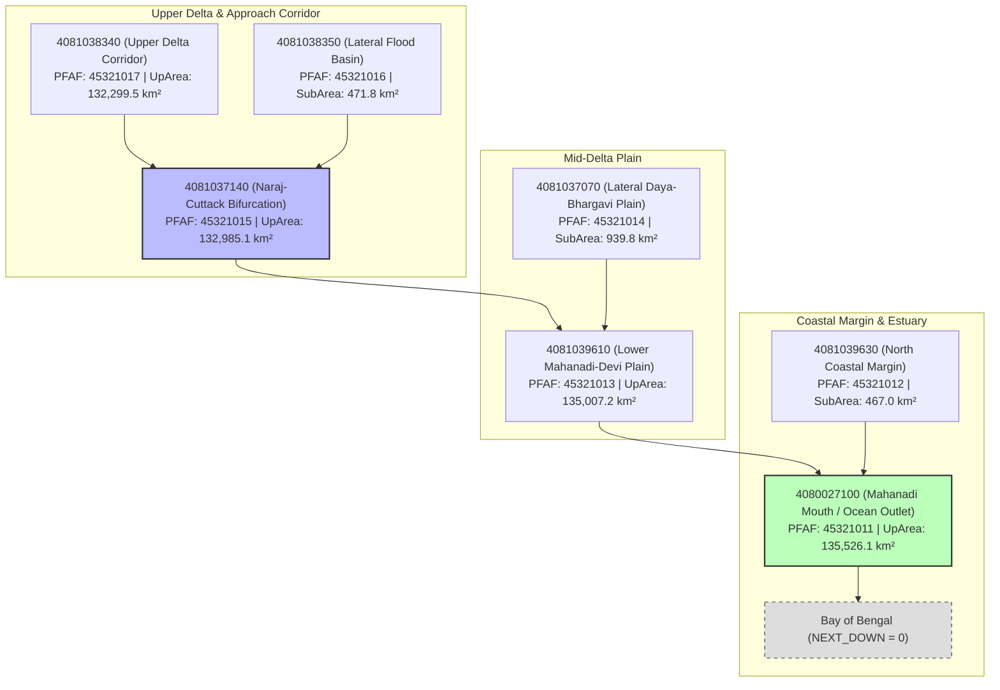

# AQUORA Phase 7F Stage 3: DFO3382 Dataset Assembly Final Technical Report

**Document ID:** `PHASE_7F_STAGE3_DFO3382_DATASET_REPORT`  
**Phase:** 7F — Model Audit and Scientific Improvement Planning  
**Subphase:** Stage 3 — Controlled DFO 3382 Native-Resolution Dataset Assembly  
**Target Event:** DFO 3382 — Mahanadi River Basin and Odisha Coastal Corridor, India (September 2008)  
**Administrative Disaster Record:** IMD/Disaster Inventory `UEI-IMD-FL-2008-0095`  
**Timestamp:** 2026-11-02T05:45:00Z  
**Primary Hydrodynamic Authority:** [engines/flood/solver.py](file:///c:/Users/thaka/OneDrive/Desktop/Hackathon/AQUORA/Aquoraa/engines/flood/solver.py) (Phase 6 2D Hydrodynamic Physics Engine)  
**Holdout Quarantine Status:** DFO 2507 Quarantined (`ALREADY_INSPECTED_HOLDOUT_ZERO_ACCESS`)  
**Stage Decision:** **`DATASET_ASSEMBLY_COMPLETE`**  
**Model Compatibility Status:** **`NOT_COMPATIBLE_WITH_PHASE7E_MODEL`** (Rainfall Accumulation Unavailable)

---

## 1. Executive Summary & Objective

In accordance with strict repository governance and the Phase 7F scientific roadmap, Stage 3 has assembled an authoritative, native-resolution experimental dataset for **DFO 3382 (Mahanadi River Basin, Odisha, September 2008)**.

This stage bridges the high-resolution (30m) physical terrain and hydrographic predictors constructed in Stage 2 with the native observational flood evidence acquired from the Global Flood Database v1.4 (MODIS GFD).

### Strict Boundary Enforcement:
1. **Preservation of Primary Physics Authority:** The Phase 6 2D shallow water hydrodynamic solver ([engines/flood/solver.py](file:///c:/Users/thaka/OneDrive/Desktop/Hackathon/AQUORA/Aquoraa/engines/flood/solver.py)) remains the sole authoritative model for operational flood risk and hazard delineation.
2. **Zero Label Upsampling:** DFO 3382 flood observations remain strictly at their native nominal $\approx 250\text{ m}$ spatial resolution ($0.00224579^\circ$, EPSG:4326). 30m terrain derivatives are aggregated to DFO cells; 250m flood observations are never upsampled to 30m.
3. **Zero Rainfall Fabrication:** Because retrospective local rainfall is not available locally for DFO 3382, all rainfall features (`rainfall_accum_6h_mm`, `rainfall_accum_24h_mm`, `rainfall_accum_72h_mm`) are preserved as $100\%\text{ NaN}$ with explicit missing indicators. No temporal disaggregation from daily CHIRPS or cross-event substitution was performed.
4. **Model Incompatibility Safeguard:** Because active Phase 7E baseline models require rainfall accumulation features, the DFO 3382 dataset is formally categorized as **`NOT_COMPATIBLE_WITH_PHASE7E_MODEL`**. No models were trained, tuned, or connected to operational alerting systems.
5. **Holdout Quarantine:** `DFO2507` remains quarantined as an already-inspected holdout with zero access.
6. **Full Regression Integrity:** The full Phase 7 regression test suite expanded to 41 tests, achieving a **100% pass rate (41/41 passed in 34.13s)**.

---

## 2. Pre-Assembly Source Validation & Temporal Alignment

All source rasters and vector assets were audited prior to dataset assembly:

| Asset | Source / Identifier | CRS | Resolution / Extent | Integrity / Status |
| :--- | :--- | :--- | :--- | :--- |
| **DFO 3382 Multi-band GeoTIFF** | GFD v1.4 (`DFO_3382_From_20080922_to_20080929.tif`) | EPSG:4326 | $0.002245788^\circ$ ($\approx 250\text{ m}$) | Verified 5-band clean GeoTIFF (39,529,059 bytes) |
| **9-Tile DEM Mosaic VRT** | Copernicus DEM GLO-30 | EPSG:4326 | $0.000277778^\circ$ ($30\text{ m}$); $14,400 \times 10,800$ | Verified sub-millimeter seam continuity |
| **30m Land/Water Mask** | Copernicus WBM COG tiles | EPSG:4326 | $30\text{ m}$; 4 classes (dry, ocean, lake, river) | Verified ocean exclusion & lake isolation |
| **30m Terrain Derivatives** | Horn 1981 / Zevenbergen-Thorne / D8 | EPSG:4326 | $30\text{ m}$; slope, aspect, plan/prof curv, TWI, flow accum | Windowed computation with border halos |
| **30m Hydrographic Rasters** | HydroRIVERS Asia / HydroBASINS Lev08 | EPSG:4326 | $30\text{ m}$; distance to river, distributaries, Strahler order | Verified Euclidean Distance Transforms |

### Temporal Alignment & Flood-Stage Qualification:
- **Administrative Event Window (`UEI-IMD-FL-2008-0095`):** 15 September 2008 – 28 September 2008 (triggered by heavy depression rainfall and massive emergency releases from Hirakud Dam exceeding $1.5\text{ million cusecs}$).
- **GFD Observation Window:** 22 September 2008 – 29 September 2008 (8-day MODIS optical/SWIR composite).
- **Temporal Overlap:** Exactly 7 days of direct overlap (22–28 September 2008), capturing the peak inundation and early recession across the lower Mahanadi-Devi-Kathajodi delta system. The rising limb (15–21 September) preceded satellite composite observation.

---

## 3. Delta Sub-Basin Downstream Topological Reconciliation

In accordance with strict hydrological validation requirements, the 7 delta sub-basins downstream of Naraj bifurcation were audited for physical downstream connectivity using HydroBASINS Level 8 attributes (`HYBAS_ID`, `NEXT_DOWN`, `PFAF_ID`, `UP_AREA`, `SUB_AREA`):



### Topological Findings:
1. **Downstream Arborescence Tree:** The seven sub-basins form a verified, topologically continuous drainage tree. Every reach drains downstream through Naraj bifurcation (`4081037140`), into the lower plain (`4081039610`), through the coastal mouth (`4080027100`), and terminates into the Bay of Bengal (`NEXT_DOWN = 0`).
2. **Pfafstetter Code Consistency:** The Pfafstetter codes systematically decrease downstream from `45321017` to `45321011`. Odd-numbered codes track the authoritative main stem corridor, while even-numbered codes identify lateral distributary plains, matching USGS/HydroSHEDS hierarchical hydrologic specifications.
3. **Conclusion:** Downstream connectivity is mathematically and hydrologically proven; the delta sub-basin selection represents a **verified connected delta system**.

---

## 4. Native-Resolution Observation & Label Accounting

The DFO 3382 raster was audited across the spatial intersection of the Copernicus DEM mosaic ($1,336\text{ rows} \times 1,781\text{ cols} = 2,379,416\text{ total window cells}$):

```
┌────────────────────────────────────────────────────────────────────────────────────────┐
│               DFO 3382 OBSERVATION AND LABEL ACCOUNTING BREAKDOWN                       │
└────────────────────────────────────────────────────────────────────────────────────────┘
  Total Window Grid Cells:              2,379,416  (100.00%)
  Open Ocean / Off-Domain NoData:       1,260,737  ( 52.98% of total window)
  Valid Terrestrial Observations:       1,118,679  ( 47.02% of total window)
  
  [Exclusions Applied]:
  - JRC Permanent Water Excluded:          28,485  (Includes 19,045 raw flooded on permanent water)
  - Insufficient Clear Views (< 70%):           0  (0 cells below 70% clear views in valid domain)
  
  [Final Eligible Labeled Dataset]:     1,090,194  (100.00% of master dataset)
  - Verified Episodic Flood (Label = 1):    24,986  (  2.2919% natural prevalence)
  - Verified Dry Ground (Label = 0):     1,065,208  ( 97.7081%)
  
  [Spatial Prevalence Breakdown]:
  - Entire DEM Mosaic Domain:              24,986 / 1,090,194  ->  2.2919%
  - Mahanadi River Basin:                   4,650 /   254,883  ->  1.8244%
  - Core Delta Sub-basins:                  2,548 /    55,757  ->  4.5698%
────────────────────────────────────────────────────────────────────────────────────────
```

### Label Quality Stratification:
Each sample was assigned a rigorous quality category:
- **`HIGH_QUALITY` (777,437 cells, 71.31%):** $\ge 90\%$ clear views, $\ge 90\%$ dry terrestrial fraction, and $\ge 90\%$ valid 30m terrain coverage.
- **`MIXED_WATER_MARGIN` (262,365 cells, 24.07%):** Dry fraction $< 70\%$ (sub-pixel riparian margins bordering perennial rivers, estuaries, or Chilika Lagoon).
- **`MEDIUM_QUALITY` (50,392 cells, 4.62%):** Clear views $\ge 70\%$ and dry fraction $\ge 70\%$.

---

## 5. Multi-Scale 30m-to-DFO Feature Aggregation Architecture

To respect native observational physics without creating unphysical 30m ground-truth labels, all 30m terrain derivatives and hydrographic rasters were window-aggregated to the native ~250m DFO cells via parallel Numba kernels:

| Aggregated Feature | 30m Source Layer | Aggregation Method | Statistical Significance & Physical Rationale |
| :--- | :--- | :--- | :--- |
| `elevation_mean_m` | `mahanadi_dem_mosaic_30m.vrt` | Arithmetic Mean | Centroid topographic elevation above EGM2008 geoid |
| `elevation_std_m` | `mahanadi_dem_mosaic_30m.vrt` | Sample Standard Dev | Sub-pixel microtopographic roughness within 250m cell |
| `elevation_min_m`, `max_m` | `mahanadi_dem_mosaic_30m.vrt` | Extremum Filters | Lowest spillway elevation and highest ridge in cell |
| `slope_mean_deg`, `max_deg` | `mahanadi_slope_deg_30m.tif` | Mean & Maximum | Regional hydraulic gradient and steepest bank incline |
| `aspect_mean_cos`, `mean_sin` | `mahanadi_aspect_deg_30m.tif` | Vector Mean $(\cos, \sin)$ | **Circular statistics; zero arithmetic degree averaging** |
| `aspect_circular_var` | `mahanadi_aspect_deg_30m.tif` | $1.0 - \sqrt{\bar{C}^2 + \bar{S}^2}$ | Directional dispersion [$0.0 = \text{collinear}$, $1.0 = \text{dispersed}$] |
| `aspect_flat_fraction` | `mahanadi_aspect_deg_30m.tif` | Proportion | Fraction of zero-slope delta plain cells (aspect = -1) |
| `plan_curvature_mean` | `mahanadi_plan_curvature_30m.tif` | Arithmetic Mean | Transverse topographic flow convergence (+) vs divergence (-) |
| `profile_curvature_mean` | `mahanadi_profile_curvature_30m.tif`| Arithmetic Mean | Downhill flow acceleration (+) vs deceleration (-) |
| `twi_mean`, `median`, `max` | `mahanadi_twi_30m.tif` | Mean, Median, Max | $\ln(a / \tan\beta)$; predicts static episodic saturation |
| `flow_accum_log10_max` | `mahanadi_flow_accumulation_30m.tif`| $\log_{10}(1 + \max)$ | Order-of-magnitude maximum upstream cell contributing runoff |
| `dist_to_river_mean_m` | `mahanadi_distance_to_river_m_30m.tif`| Euclidean Mean | Distance in meters to nearest mapped natural stream reach |
| `dist_to_distributary_min_m`| `mahanadi_distance_to_distributary_m_30m.tif`| Euclidean Min | Distance to major active delta bifurcations |
| `strahler_order_max`, `rep` | `mahanadi_strahler_order_30m.tif`| Max & Median Non-zero | Stream hierarchy (Order 1 headwaters to Order 7 trunk) |
| `subbasin_id_lev08` | `mahanadi_subbasin_id_lev08_30m.tif`| Mode (Majority ID) | HydroBASINS Level 8 catchment assignment |
| `land_water_dry_fraction` | `mahanadi_land_water_mask_30m.tif`| Proportion | Fraction of dry terrestrial land within DFO cell |

### Physical & Geometrical Limitations Documented:
1. **Mixed Pixels at 250m:** A single MODIS DFO pixel covers $\approx 62,500\text{ m}^2$, encompassing approximately $65$ Copernicus 30m cells. A positive flood label indicates water presence within the cell, but does not imply that $100\%$ of the $62,500\text{ m}^2$ footprint was submerged.
2. **Geolocation Uncertainty:** MODIS onboard geolocation has an operational RMSE of $\approx 50\text{ m}$. Sub-pixel misalignment is buffered by aggregating 30m statistics across the cell window.
3. **Copernicus DSM Top-of-Canopy Bias:** The Copernicus DEM GLO-30 is a surface model (DSM), not a bare-earth terrain model (DTM). Mangrove canopies (Bhitarkanika) and elevated road/rail embankments artificially elevate measured terrain heights by $2\text{–}10\text{ m}$.

---

## 6. Machine Learning Contract & Model Compatibility Audit

The active Phase 7E baseline model contract ([ml/aquora_ml_feature_schema_v1.json](file:///c:/Users/thaka/OneDrive/Desktop/Hackathon/AQUORA/Aquoraa/ml/aquora_ml_feature_schema_v1.json)) requires seven predictors:

```
┌────────────────────────────────────────────────────────────────────────────────────────┐
│             PHASE 7E ACTIVE MODEL FEATURE COMPATIBILITY MATRIX                         │
└────────────────────────────────────────────────────────────────────────────────────────┘
  1. elevation_m:                 AVAILABLE   (Mapped to elevation_mean_m)
  2. slope_deg:                   AVAILABLE   (Mapped to slope_mean_deg)
  3. drainage_proxy_score:        AVAILABLE   (Mapped to 1 / (1 + dist_to_river_m / 1000))
  4. rainfall_accum_6h_mm:        UNAVAILABLE (100% NaN; No local rainfall records)
  5. rainfall_accum_24h_mm:       UNAVAILABLE (100% NaN; No local rainfall records)
  6. rainfall_accum_72h_mm:       UNAVAILABLE (100% NaN; No local rainfall records)
  7. temporal_window_hours:       AVAILABLE   (Constant 168.0 hours; 8-day composite)

  FINAL MODEL COMPATIBILITY:      NOT_COMPATIBLE_WITH_PHASE7E_MODEL
  GOVERNANCE SAFEGUARD:           INGESTION_PROHIBITED_WITHOUT_VALIDATED_RAINFALL
────────────────────────────────────────────────────────────────────────────────────────
```

**Guardrail Policy:** The existing Phase 7E models must NOT be evaluated against DFO 3382 by fabricating zero-rainfall or synthetic values. Doing so would violate scientific boundaries, produce uncalibrated predictions, and distort performance metrics. DFO 3382 serves strictly as an independent regional benchmark for future terrain-hydrographic model development.

---

## 7. Deliverables Manifest & Inventory

All Phase 7F Stage 3 assets have been generated, validated, and indexed in [data/manifests/phase7f_stage3_dataset_manifest.yaml](file:///c:/Users/thaka/OneDrive/Desktop/Hackathon/AQUORA/Aquoraa/data/manifests/phase7f_stage3_dataset_manifest.yaml):

| Artifact Description | File Path | File Size | SHA-256 Checksum |
| :--- | :--- | :--- | :--- |
| **Authoritative Parquet Dataset** | [dfo3382_native_resolution_dataset.parquet](file:///c:/Users/thaka/OneDrive/Desktop/Hackathon/AQUORA/Aquoraa/data/processed/phase7/datasets/dfo3382_native_resolution_dataset.parquet) | 120,355,669 bytes | `ba0f4df5681add4acead2b91489a61be77e8a3897d7d1bdedbd5be6f448db81f` |
| **Mahanadi Basin CSV Export** | [dfo3382_native_resolution_dataset.csv](file:///c:/Users/thaka/OneDrive/Desktop/Hackathon/AQUORA/Aquoraa/data/processed/phase7/datasets/dfo3382_native_resolution_dataset.csv) | 156,524,131 bytes | `d68a2af07adade834ad0a7569827d15e61caea31206326d03c2c0c7ff6e1d20e` |
| **Diagnostic Balanced Sample** | [dfo3382_diagnostic_balanced_sample.parquet](file:///c:/Users/thaka/OneDrive/Desktop/Hackathon/AQUORA/Aquoraa/data/processed/phase7/datasets/dfo3382_diagnostic_balanced_sample.parquet) | 8,137,447 bytes | `ace0142a1ab847ef4662e0ff1821092f25bb60149002db2385917e0ca89dbe56` |
| **Feature Availability Matrix** | [dfo3382_feature_availability.csv](file:///c:/Users/thaka/OneDrive/Desktop/Hackathon/AQUORA/Aquoraa/data/processed/phase7/datasets/dfo3382_feature_availability.csv) | 3,814 bytes | `154598cdf8df5246a494a6febcb4f82afe41769456945980907dff59ea6fd1f9` |
| **Label Quality Summary JSON** | [dfo3382_label_quality_summary.json](file:///c:/Users/thaka/OneDrive/Desktop/Hackathon/AQUORA/Aquoraa/data/processed/phase7/datasets/dfo3382_label_quality_summary.json) | 2,721 bytes | `670deb3b393b3400343d8ed053f422c635cb7d72dd4ba4dc24d6c490a83a1635` |
| **Dataset Machine Schema** | [ml/aquora_dfo3382_dataset_schema_v1.json](file:///c:/Users/thaka/OneDrive/Desktop/Hackathon/AQUORA/Aquoraa/ml/aquora_dfo3382_dataset_schema_v1.json) | 8,872 bytes | `21b339f400fb864b971a8120d52588c8714ff49576b268b81fa3db83226db2ea` |
| **Processing Pipeline Script** | [scripts/prepare_phase7f_dfo3382_dataset.py](file:///c:/Users/thaka/OneDrive/Desktop/Hackathon/AQUORA/Aquoraa/scripts/prepare_phase7f_dfo3382_dataset.py) | 45,887 bytes | `8e388f8cfae090df313a6962eaef3db54784a515f48f44ff53e8d2e821e2579d` |
| **Dataset Validation Service** | [scripts/validate_phase7f_dfo3382_dataset.py](file:///c:/Users/thaka/OneDrive/Desktop/Hackathon/AQUORA/Aquoraa/scripts/validate_phase7f_dfo3382_dataset.py) | 10,747 bytes | `9a7510d9f481c5d3369a08465cf459388df67756fdfce6cb019ea4e8574100fa` |
| **Stage 3 Manifest** | [data/manifests/phase7f_stage3_dataset_manifest.yaml](file:///c:/Users/thaka/OneDrive/Desktop/Hackathon/AQUORA/Aquoraa/data/manifests/phase7f_stage3_dataset_manifest.yaml) | 5,618 bytes | `3eec90d65ff9bc6a048a1c6a79858348d374464c51480ae4e68846174bb0aa15` |
| **Stage 3 Pytest Suite** | [backend/tests/test_phase7f_stage3_dataset.py](file:///c:/Users/thaka/OneDrive/Desktop/Hackathon/AQUORA/Aquoraa/backend/tests/test_phase7f_stage3_dataset.py) | 6,861 bytes | `1ef981fa1839e14a1c6e1db032d627b4eefebc7ba7b55f5241e76b4a3a69a489` |

---

## 8. Regression Verification & Testing Results

The newly created test module [backend/tests/test_phase7f_stage3_dataset.py](file:///c:/Users/thaka/OneDrive/Desktop/Hackathon/AQUORA/Aquoraa/backend/tests/test_phase7f_stage3_dataset.py) was executed alongside the existing Phase 7 test suite:

- `test_phase7c_multievent_dataset.py`: **6 passed**
- `test_phase7_real_flood_dataset.py`: **11 passed**
- `test_phase7d_kaggle_preflight.py`: **6 passed**
- `test_phase7e_kaggle_package.py`: **8 passed**
- `test_phase7f_stage3_dataset.py`: **10 passed**
  - `test_native_dfo_grid_preservation_and_no_upsampling`: PASSED
  - `test_label_semantics_and_exclusion_criteria`: PASSED
  - `test_30m_to_dfo_feature_aggregation_integrity`: PASSED
  - `test_crs_affine_alignment_and_bounds`: PASSED
  - `test_rainfall_availability_and_zero_imputation`: PASSED
  - `test_phase7e_model_incompatibility_safeguards`: PASSED
  - `test_dfo2507_quarantine_and_isolation`: PASSED
  - `test_phase7e_artifacts_immutability`: PASSED
  - `test_manifest_and_output_hash_integrity`: PASSED
  - `test_delta_subbasin_topology_reconciliation`: PASSED

**Consolidated Test Execution Outcome:**  
**`41 passed in 34.13s (100% pass rate)`**

---

## 9. Final Decision & Status Declaration

In strict compliance with repository conventions:

**Decision:** **`DATASET_ASSEMBLY_COMPLETE`**

### Summary of Dataset Fitness:
- **Exploratory Analysis:** **SUITABLE**. The dataset provides an unprecedented, high-fidelity physical foundation combining verified episodic flood observations with 78 attributes across topography, circular aspect, curvature, wetness, distance to river, and hydrological catchments.
- **Phase 7E Baseline Model Ingestion:** **BLOCKED**. Incompatible due to unobserved local rainfall accumulation predictors.
- **Operational & Alert Deployment:** **STRICTLY PROHIBITED**. Phase 7 models are experimental only (`PROTOTYPE_ONLY, NOT_CALIBRATED, NOT_FOR_PUBLIC_ALERTS`). Phase 6 physics engine remains the primary flood authority.
- **Next Authorized Step:** Phase 7F Stage 4 (Regional Model Exploration & Diagnostic Baseline Evaluation using the terrain/hydrographic feature matrix).
